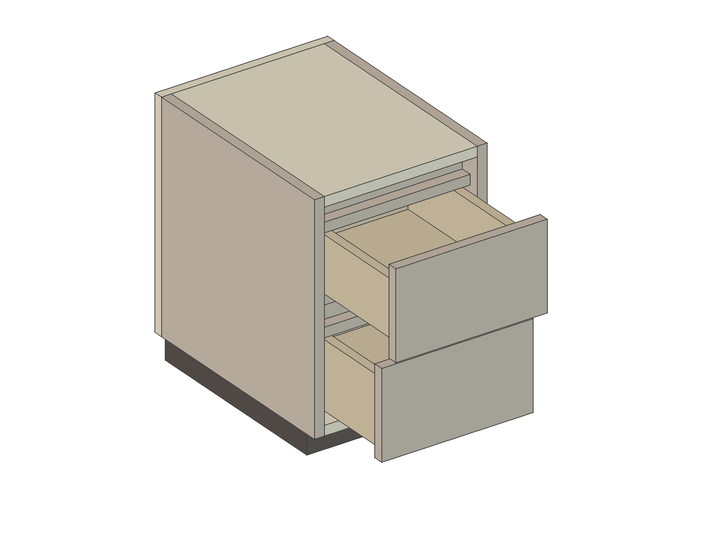
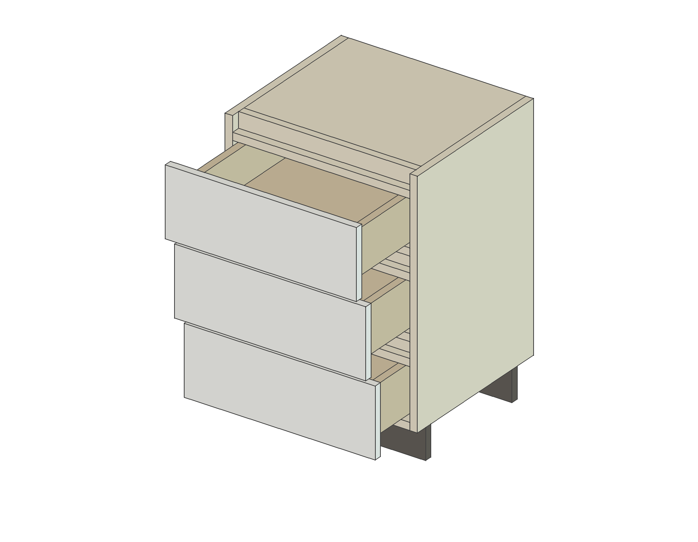
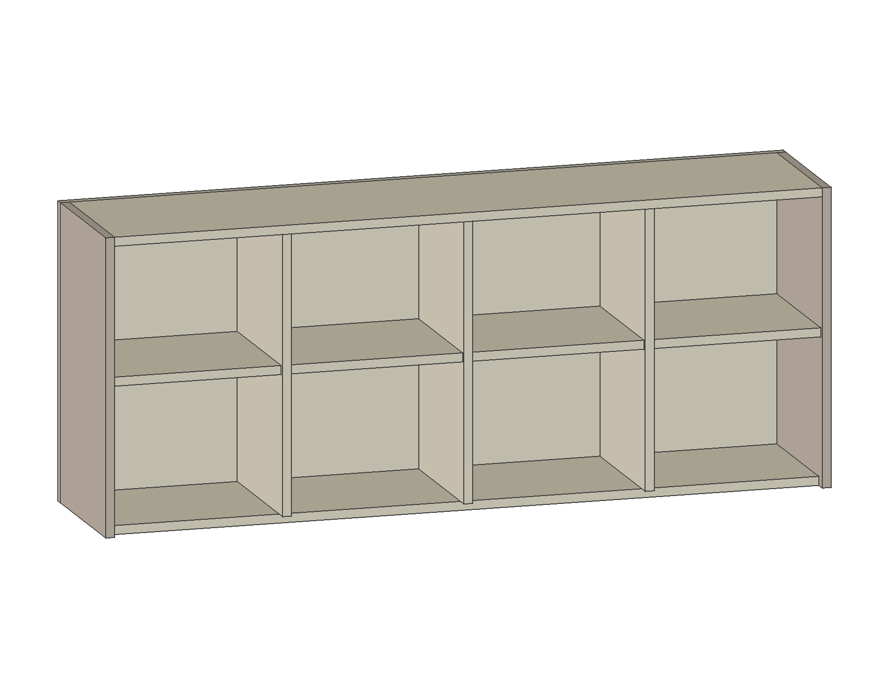
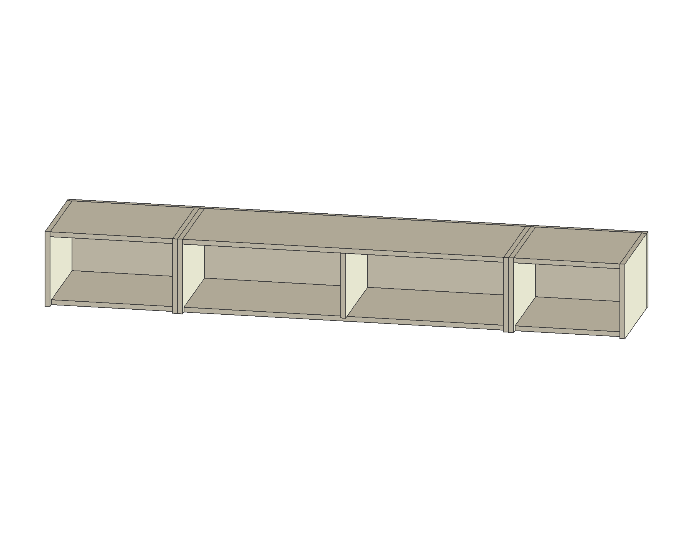

# Current design review — bed v7 / cabinet v9 — 2026-11-15

The wheel conversion, stock reconciliation, split headboard, real plinth strips, per-edge cutting allowances, native layouts and illustrated manuals are now implemented as a **provisional hardware-dependent planning revision**. See [workshop guide](WORKSHOP_GUIDE.md) and [LED wiring](LIGHTING_AND_WIRING.md).

- 24 fixed-direction one-inch wheels on six floor-running drawers; open bay floors, lateral guides, mounting pads and retention-strap schedule. Actual 35 mm mounting-height assumption and wheel load rating must be verified.
- 207 / 97 individual panels; 12 / 9 stock sheets in achieved separate-project layouts, with kerf, trim, edge-band deductions, labels and saw-cut sequence. These are planning layouts, not a final fabrication release.
- Aluminium LED profiles, strips, diffusers, accessible driver spaces and cable routes in both saved models. Provisional 24 V / 10 W/m and 30 W drivers; actual electrical/thermal specifications still pending.
- Headboard backing/substrate split into halves and nightstand plinths decomposed into strips. Two-face-laminated thickness used throughout. Adjacent lift-up lids have 3 mm gaps.
- Saved geometry and panel/LED clearances checked; sampled drawer translations pass. Stock-layout validation checks every panel once, bounds and kerf separation. Native pages are embedded and PDFs checked.
- Square plywood L/C drawer grips, solid outside ends, plain door cabinets and overhead dividers retained. Nightstand and makeup-cabinet runner hardware is unchanged.
- Still unresolved: delivered stock/edge-band measurements and grain, purchased caster/hinge/runner/fixing details, actual floor and wall conditions, structural load capacity, selected LED kit/thermal ventilation/wire ratings, and the old combined room file's empty links. Opening a foot drawer leaves only 68.4 mm to the opposite cabinet, not walking space.

The previous audit below is retained as history; its “pending” statements refer to bed v6 / cabinet v8, not the current implementation.

---

# Historical audit — before the wheel / lighting / cutting revision

# Bedroom furniture design review — updated 2026-11-15

The current saved revisions are `Bed_Wall_Unit_v6.FCStd` and
`Bedroom_Cabinet_Modern_v8.FCStd`. They include the divider corrections below.
The current models also use plywood L/C pull channels and square-edged fronts. The wheel conversion, stock reconciliation, and lighting revision are still pending.

## Completed: plywood L/C pull channels and square fronts

See [construction details](PLYWOOD_PULLS.md). The new channel members are actual
plywood parts in both saved models and in the cut lists. They end between the existing
solid sides. Exposed outside-panel notches and channels on door-only cabinets have
been removed. No cover plywood is added. All 28 door/drawer fronts are square solids. Closed-position checks
and sampled drawer translations pass without intersections. Wardrobe internal drawers return to their original width and 400 mm runners; the
extra partition and vertical channel assembly from the earlier revision are removed. Scribe strips now report their actual 19.6 mm stock thickness.

## Completed: overhead cabinet compartments

- Bed: three full-height dividers create four separate compartments. The former
  1554 mm shelf is replaced by four panels, 368.9 / 378.7 / 378.7 / 368.9 mm wide.
- TV/makeup cabinet: the two-door centre top box has a centre divider. The two
  single-door side top boxes already have their own compartments.
- Existing outside dimensions and door sizes are preserved. The bed's overhead
  doors remain 395.3 mm wide; the correction divides the interior behind them.
- The two middle bed overhead doors mount to opposite faces of the centre divider
  with half-overlay hinges. The outside doors mount on the outside sides.

## Findings to resolve before final cutting layouts

| Finding | Evidence in the saved design | Required correction |
| --- | --- | --- |
| Two headboard plywood parts cannot be cut from a 4×8 sheet | Backer 1593.2 × 1717 mm; upholstery base 1587.2 × 1450 mm. Both exceed the 1220 mm stock width in either orientation. | Split the plywood backing into sheet-sized panels and keep the upholstery appearance continuous. Update the model and cut list together. |
| Bed stock does not yet match the user's material requirement | Bed v4 cut list has 54 pieces recorded as raw 18 mm and one 12 mm upholstery base, alongside the 19.6 mm laminated panels. | Reconcile furniture panels with 3/4-inch plywood laminated on both faces. Recalculate internal drawer dimensions and clearances when thickness changes. |
| Corrected in bed v6 / cabinet v8: narrow scribe-strip thickness fields | The scripts sort all three box dimensions. A 10 mm-wide strip made from 19.6 mm stock is consequently listed as 10 mm thick. This affects one bed strip and two TV/makeup cabinet strips. | New builders record actual panel thickness separately; narrow width stays in the width column. |
| Nightstand plinth cut-list entries describe assemblies | Two 301.4 × 400 × 57 mm blocks represent rings of four strips, rather than individual plywood parts. | Model and list the actual ring strips so the nesting layout does not treat 57 mm as plywood thickness. |
| Edge-band allowances are not included in existing cutting sizes | The model supplies panel sizes; the older materials helper estimates banding, but the cut CSV does not deduct band thickness or identify all four banded edges. | Specify each exposed edge and export finished panel sizes separately from plywood blank sizes. Deduct the selected band thickness on the corresponding edges once. |
| Floor-running wheels would be obstructed by the existing drawer-bay bottoms | Six under-bed drawer bays currently contain raised bottom panels on 20 mm cleats. | Confirm the rolling surface. For floor-running wheels, redesign the bottom panels/bracing to clear the wheel paths; for an internal track, provide a continuous supported rolling surface through the intended travel. |
| Wheel diameter is not installed height | Only 1-inch / 25.4 mm wheel diameter is specified. Brackets and mounting plates are not specified. | Confirm fixed roller versus swivel caster and measure the floor-to-mounting-surface height. Set drawer height and any mounting spacers from that measurement. |
| Wheel drawers need their own travel control | Side clearance is 351.4 mm; the existing side opening travel is 337 mm, leaving 14.4 mm to the wall. Foot drawers use 450 mm travel in a 520 mm walkway, leaving 70 mm to the opposite cabinet. | Include drawer guidance and removable stops compatible with wheels. Preserve the room clearance limits in the model and drawings. |
| Strip lighting is currently represented only in part | The bed has two niche strip-light blocks and two bridge puck lights. Wire routes, mounting profiles, and a serviceable driver arrangement are not modeled. The TV/makeup cabinet has no strip-light arrangement. | Confirm lighting locations, then provide profile space, cable routes clear of moving parts/hinges, and accessible driver space. Size the electrical components from the actual strip specifications. |
| The combined room file is not usable as a linked assembly | `Bedroom_Layout.FCStd` contains 17 links with no targets. | Repair its link construction and point a new room revision to the finalized furniture models. The two individual furniture files work separately. |

The 70 mm space with a foot drawer fully open is a clearance result, not usable
walking space. Review the opening arrangement in the room before treating it as final.

## Cutting-layout requirements

The user wants a presentation like [CutList Optimizer](https://www.cutlistoptimizer.com/):
labelled parts on stock sheets, dimensions and quantities, material, kerf, edge trim,
sheet utilization, offcuts, and edge-band information.

- Required stock: 3/4-inch plywood, laminated on both faces, with edge banding.
- Existing model assumption: 18 mm plywood + 0.8 mm laminate per face = 19.6 mm.
  The actual purchased stock thickness still needs to be measured.
- Previous project assumptions: 1220 × 2440 mm sheets, 4 mm saw kerf, 5 mm edge trim,
  and 1 mm edge band. Keep these explicit until the user supplies actual values.
- Identify the four panel edges individually. Edges parallel to the panel length
  reduce the plywood blank width when banded; banded end edges reduce blank length.
- Record any grain/orientation restriction; do not silently rotate grain-sensitive parts.
- Export separate project lists, with a combined nesting option only when stock and
  laminate finish match. The current cut lists are reference lists pending the audit fixes.
- Do not release a final nesting result while oversized parts, composite plinth entries,
  stock inconsistencies, or wheel-dependent drawer dimensions remain unresolved.

## Checks completed

- Both revised models open in FreeCAD 1.1.4 on CachyOS.
- All non-null solid shapes checked are valid.
- Divider-to-panel intersection checks pass.
- The plywood-channel revision passed pairwise checks with 164 bed furniture objects and
  100 TV/makeup furniture objects, excluding reference objects and LED placeholders.
  Sampled drawer translations at 1, 20, 42, 80, 150 mm and full travel also passed.
  These checks cover the modeled geometry, not hardware/load ratings.
- The bed drawing has three valid TechDraw pages; its overhead view shows the dividers.
- Seven original model/script/drawing/cut-list files were hash-checked and remain unchanged.

Every major subsequent design revision must include fresh screenshots in the
authoritative Obsidian session under `Project Idea/Bedroom Cabinet/session.md`.
