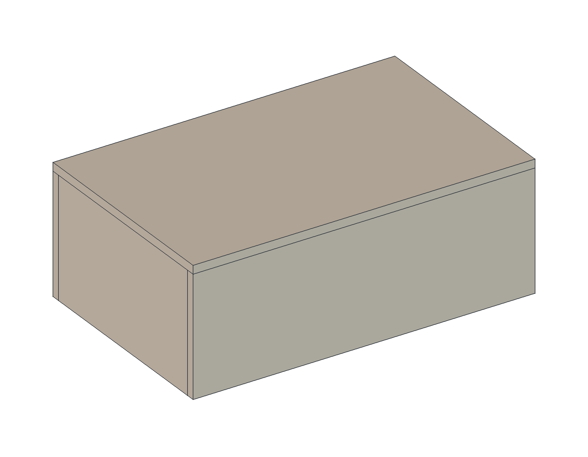
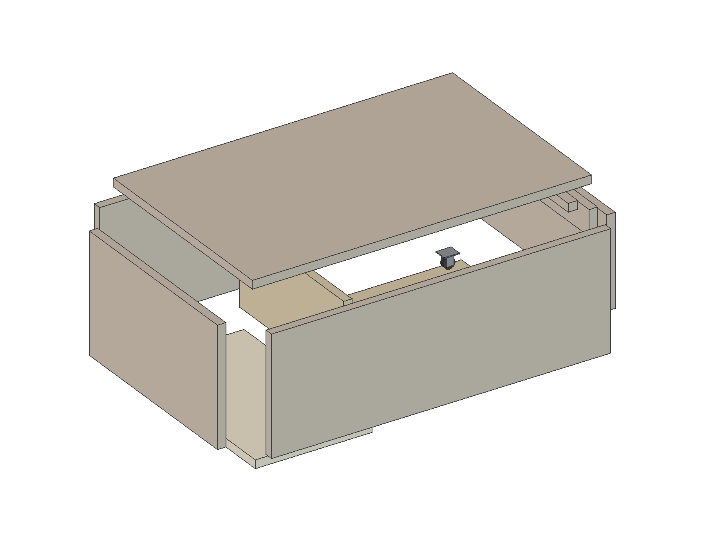

# Edge banding and manual cutting

**Build one complete module, then move to the next.**

[Bed — module-by-module assembly PDF](workshop/bed/Module_by_Module.pdf) · [Cabinet — module-by-module assembly PDF](workshop/cabinet/Module_by_Module.pdf)

[Bed: individual module checklist](workshop/bed/modules/README.md) · [Cabinet: individual module checklist](workshop/cabinet/modules/README.md)

| Example: completed side drawer bay | Same bay — exploded construction |
| --- | --- |
|  |  |

Each module pack includes assembled / exploded / interior views, its own whole-mm parts targets and banding diagrams, build steps and a completion checklist. **Bed: 14 modules + final installation. Cabinet: 7 module groups + final installation.** Build that module's own drawers before moving on, subject to actual hardware fit. The TV centre and drawer tower share structure. Every plywood part appears once across the module packs; final site-fit scribes are assigned to installation.

Sheet nesting remains a separate cutting-batch plan: gather labelled parts from their stock sheets into each module kit. Rounded targets still require dry-fit; connector / wall-fixing patterns and hardware fit are not finalized by these guides.

Do not edge-band all parts. Each new manual cut-sheet row has an ID, whole-mm blank targets, a diagram and a band instruction.

- Orange edge: apply the scheduled band.
- Grey edge: leave it unbanded.
- NONE: no band on that part.
- ALL FOUR: band both long and both short edges.
- L1/L2 follow the Length dimension; W1/W2 follow Width. Keep labels attached to the part when rotating it. These are diagram references, not necessarily installed top/bottom/left/right.

Doors and drawer fronts generally have all four edges scheduled. Many fixed sides/shelves have one exposed edge scheduled. Hidden backs, bottoms and mating faces often have none. Always follow the individual ID rather than applying these general patterns indiscriminately.

Band flags are reproduced from the existing CAD schedule, including its default exposure assumptions. They have not been re-audited as a new joinery design. For single-edge parts, mark the actual exposed edge against the assembled model during dry-fit; do not infer the installed orientation from the small rectangle. Do not add banding on mating edges without revising the fit.

Blank dimensions already deduct the assumed band thickness. Apply the scheduled band after cutting, then trim it flush. Assumed band thickness is 1 mm; measure the supplied band and laminated plywood before final sizing.

The new manual sheets round blanks to whole-mm measuring targets. They are not a checked integer-dimension redesign. Dry-fit related parts before final sizing. Original nesting maps and saw coordinates use exact CAD dimensions and must not be mixed with rounded targets without replanning the cuts.

Print on short bond / Letter in landscape with Fit to printable area. Read dimensions; never measure the paper diagram.

## Assembly notes discussed

Use wood/furniture screws, identified by specification rather than black colour. A 4 x 40 mm countersunk wood screw is a proposed starting size for ordinary plywood butt joints, not a universal bed fastening specification. A 16 mm pan-head wheel screw is only a candidate until actual caster plate holes, board thickness and fastener engagement are checked. Module connector bolts and wall anchors are separate.

Bare wood-to-wood permanent joints can use wood glue plus suitable fixings. Bare edge-to-laminate joints require an adhesive explicitly rated for that combination plus mechanical joints. Ordinary wood glue is not a substitute for mechanical joints against smooth laminate. Wheel plates use mechanical fixings, not glue. Leave removable module connections unglued.

No geometry, band quantities or hardware-dependent fits were changed by this document update. Bed v9 direct wheel mounts and cabinet v9 remain current.
