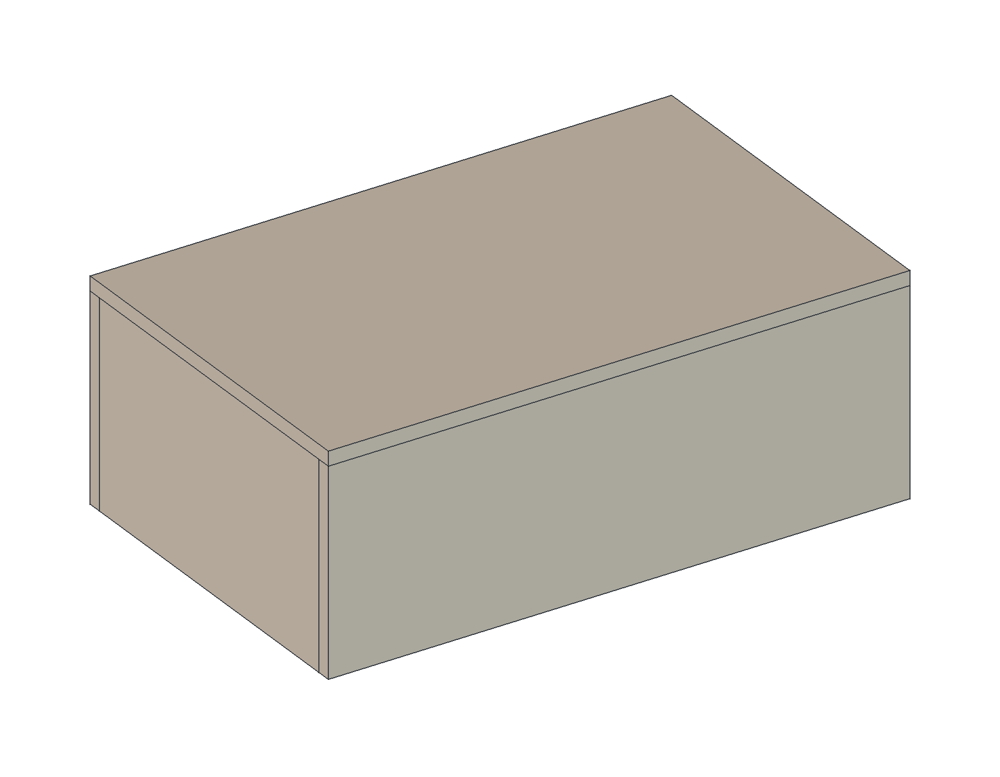
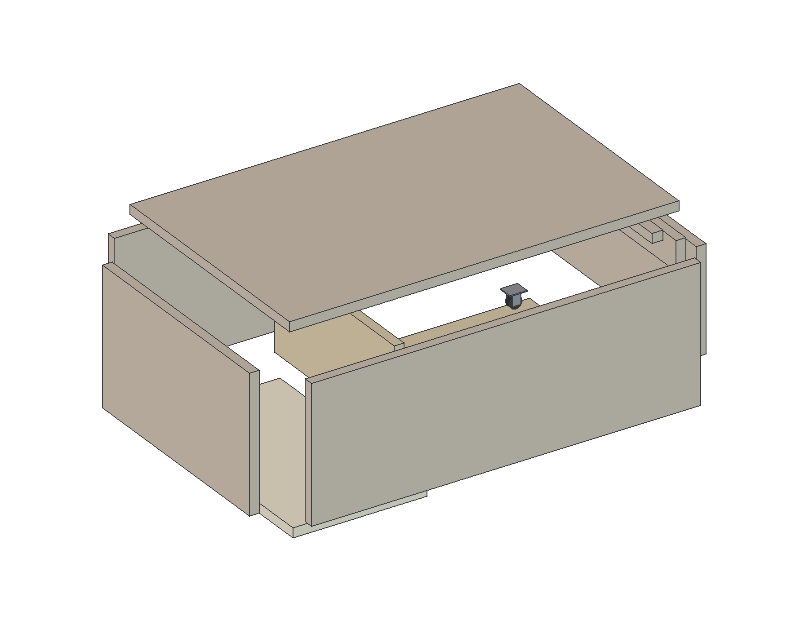

# Cabinet LED lighting — bed v8 / TV and makeup cabinet v9

**Build one complete module, then move to the next.**

[Bed — module-by-module assembly PDF](workshop/bed/Module_by_Module.pdf) · [Cabinet — module-by-module assembly PDF](workshop/cabinet/Module_by_Module.pdf)

[Bed: individual module checklist](workshop/bed/modules/README.md) · [Cabinet: individual module checklist](workshop/cabinet/modules/README.md)

| Example: completed side drawer bay | Same bay — exploded construction |
| --- | --- |
|  |  |

Each module pack includes assembled / exploded / interior views, its own whole-mm parts targets and banding diagrams, build steps and a completion checklist. **Bed: 14 modules + final installation. Cabinet: 7 module groups + final installation.** Build that module's own drawers before moving on, subject to actual hardware fit. The TV centre and drawer tower share structure. Every plywood part appears once across the module packs; final site-fit scribes are assigned to installation.

Sheet nesting remains a separate cutting-batch plan: gather labelled parts from their stock sheets into each module kit. Rounded targets still require dry-fit; connector / wall-fixing patterns and hardware fit are not finalized by these guides.

Both saved models now contain real aluminium U-channel envelopes, separate LED strip and diffuser parts, accessible driver/distribution envelopes, orange two-core DC cable routes, and passages through intersecting plywood panels. The aluminium light profiles are separate from the **plywood L/C drawer grips**.

This is a **provisional 24 V constant-voltage lighting plan**. No purchased LED kit has been confirmed. Assumptions: 10 W/m strip, 16 × 10 mm surface-mounted profile, 30 W driver per project. Confirm the actual strip voltage, W/m, cut pitch, profile, driver cooling requirements, wire gauge, fuse and connectors before buying or drilling. LED cut lengths must be adjusted to the strip's marked cutting interval; profile lengths below are the available design lengths.

| Project / branch | Location | Profile length mm | Load at assumed 10 W/m | Two-core cable including 200 mm service allowance |
| --- | --- | ---: | ---: | ---: |
| Bed B_L | Left lit niche, under shelf | 282.2 | 2.822 W | 1853.2 mm |
| Bed B_R | Right lit niche, under shelf | 282.2 | 2.822 W | 3327.0 mm |
| Bed B_H | Under bridge, headboard wash | 1514.0 | 15.140 W | 948.8 mm |
| Cabinet C_T | Under TV ledge above vanity | 760 | 7.600 W | 1805.4 mm |
| Cabinet C_L | Left of mirror | 410 | 4.100 W | 1901.4 mm |
| Cabinet C_R | Right of mirror | 410 | 4.100 W | 2635.4 mm |

Bed load: **20.784 W / 0.866 A at 24 V**. With a 25% design margin, minimum planned capacity is 25.98 W; a 30 W driver is provisional. Cabinet load: **15.8 W / 0.658 A**, or 19.75 W with the same margin. This margin is our design allowance; the manufacturer's thermal and installation limits still control. Extra lighting requires a new load calculation.

## Connection and installation order

1. Use an existing outlet and a suitably certified plug-in constant-voltage LED supply. Match the driver's DC voltage to the strips; do not mix 12 V and 24 V equipment. Any new fixed mains wiring or outlet needs a qualified electrician and a site-specific plan. The model does not establish the existing outlet location.
2. Fit the aluminium profiles, suitable clips/end caps, then the LED strips and removable diffusers. The extrusion allowance is an envelope, not a selected manufacturer's section or screw pattern.
3. Drill the modelled DC cable passages before assembling the cases. The 9 mm bores are grommet allowances; match them to the actual grommet outside diameter before drilling. Do not leave sharp plywood edges against cable.
4. Route and secure two-core cable along fixed rear panels. Keep clear of hinges, drawer runners, wheels and the grip recesses. The model's orange line represents the **two-core sheath**, not a bare positive conductor. Coincident branch segments indicate a shared bundle route; lay actual cables side by side and size the grommet for the bundle.
5. With the supply unplugged, connect its DC output to rated fused distribution and a compatible dimmer/switch. Connect each branch **in parallel**: positive to positive, negative to negative. The wiring drawings label the branch names and polarity. Red denotes +24 V, black denotes 0 V/negative; dots denote electrical connections.
6. Cut strips only at marked copper cutting pads. Use compatible connectors or properly insulated solder joints. Keep a service loop and make connectors accessible. Cable schedule lengths include 200 mm slack but exclude site-specific mains cords and connector tails.
7. Choose conductor size, fuse and connector ratings from the actual branch current, length, allowable voltage drop and product instructions. These ratings are **not finalized** in this revision. Avoid feeding one long strip through the end of another: the illustrated branches have separate feeds.
8. Test every branch and polarity before clipping on diffusers. Check driver temperature and ventilation against its datasheet. Do not seal the driver inside a plywood box or cover it with stored fabric.
9. Driver access: **left upper bed cabinet** and **left top box of the TV/makeup cabinet**, through their doors. Each has a provisional 180 × 60 × 35 mm driver envelope and a reserved 200 × 80 × 70 mm space; actual required clearances may be greater. Keep that space clear and revise the enclosure if the chosen driver requires more ventilation.

The previous bed-only 12 V strip/puck placeholders are replaced by these strip branches. If you already own 12 V strips, revise `VOLTAGE` in `cabinet_lighting.py`, choose the matching 12 V supply and recalculate current, conductor and fuse ratings. Do not use the current 24 V driver assumption for them.

## Open inside FreeCAD

- Open `Bed_Wall_Unit_v8.FCStd` or `Bedroom_Cabinet_Modern_v9.FCStd`.
- Expand **LED Lighting** to inspect profiles, strip, diffuser, driver and cable routes.
- Expand **Assembly Manual** → **LED Wiring** to open the drawing; **LightingSchedule** lists branches and cable lengths.
- [Bed wiring PDF](workshop/bed/LED_Wiring.pdf) · [Cabinet wiring PDF](workshop/cabinet/LED_Wiring.pdf).

The modelled cable passages have been checked against the profile/driver/cable envelopes and furniture panels. This checks fit, not the purchased product's electrical certification, heat performance or the furniture's load capacity.

## Sources

Voltage matching and DC connection principles: [Waveform Lighting — How to Connect an LED Strip to a Power Supply](https://www.waveformlighting.com/home-residential/how-to-connect-an-led-strip-to-a-power-supply).

Separate branch feeds and voltage-drop considerations: [Waveform Lighting — Connecting LED Strips in Series vs Parallel](https://www.waveformlighting.com/home-residential/connecting-led-strips-in-series-vs-parallel).
