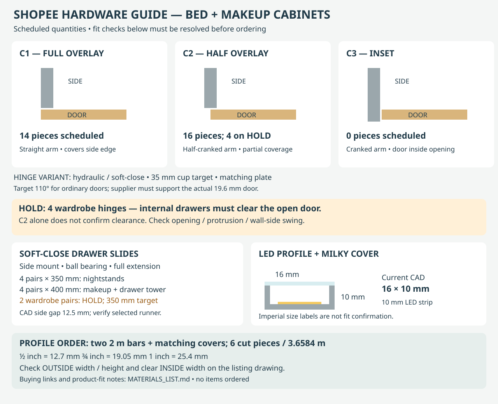

# Materials and hardware — both bedroom projects

Checked against bed v8 / TV-makeup cabinet v9 schedules and saved sheet layouts, 2026-11-15. These are planned quantities, not confirmation of purchased products. Plain-backboard revision: one plywood face, three narrow timber battens; no foam/fabric or extra plywood substrate. **User confirmed all plywood is already laminated on both faces; no face-laminating contact cement or additional face laminate is required.**

| Item | Bed and cabinets | TV / makeup cabinet | Combined planned quantity |
| --- | ---: | ---: | ---: |
| C1 full-overlay soft-close hinge; 110° target, product fit pending | 10 | 4 | **14 pieces** |
| C2 half-overlay soft-close hinge; 4 wardrobe hinges ON HOLD | 4 | 12 | **16 pieces** |
| Matching hinge mounting plate | 14 | 16 | **30 pieces** |
| Soft-close side-mount drawer slide, 350 mm | 4 pairs | 0 | **4 pairs** |
| Soft-close full-extension side-mount slide, 400 mm, old schedule | 0 | 6 pairs | **4 pairs for makeup/tower; 2 wardrobe pairs ON HOLD**; proposed wardrobe length 350 mm |
| Fixed-direction wheel / roller, 1-inch / 25.4 mm diameter | 24 | 0 | **24 pieces**, four per under-bed drawer |
| 3/4-inch plywood, laminated on both faces, 2440 x 1220 mm | 11 sheets | 9 sheets | **20 sheets in current separate layouts** |
| Edge band, assumed 1 mm thick, width covering finished 19.6 mm board | 101.999 m including trim allowance | 57.656 m including trim allowance | **159.655 m; buy 102 m bed + 58 m cabinet when sold per metre** |
| Aluminium LED profile WITH diffuser cover, provisional 16 x 10 mm envelope | 3 cut pieces / 2.0784 m | 3 cut pieces / 1.5800 m | **6 pieces / 3.6584 m installed; two 2 m bars with two matching 2 m covers suffice** |
| Profile end caps, matched to extrusion | 6 | 6 | **12**, including cable-entry types as appropriate |
| LED strip, provisional 24 V / 10 W per metre | 2.0784 m | 1.5800 m | **3.6584 m nominal**; one 5 m roll if both use the same strip specification/colour |
| Constant-voltage LED driver, provisional 24 V / 30 W | 1 | 1 | **2**; actual specifications still require confirmation |
| DC dimmer/distribution arrangement | 1 | 1 | **2 sets**, with rated connections/protection |
| Solid-timber backboard battens, 1507.2 x 50 x 40 mm | 3 | 0 | **3 pieces; not plywood** |
| Contact cement for face lamination | 0 L | 0 L | **0 L — user confirmed all plywood is already laminated** |

Slide quantities are **pairs**: 10 pairs = 20 individual side rails. The six under-bed drawers have wheels and **no metal drawer slides**.

## Shopee buying guide

**Use Shopee Philippines for shopping.** Links below are candidates or clearly labelled searches, not purchased or fully approved hardware. Manufacturer references below are for dimensions only.

| Item / Shopee label | Scheduled quantity | What to select / fit status |
| --- | ---: | --- |
| **C1 — full overlay / straight arm** | **14 pieces / 7 pairs** | Hydraulic soft-close; ordinary-door target 110°, 35 mm cup; selected hinge must support the actual 19.6 mm door, overlay and mounting plate. |
| **C2 — half overlay / half-cranked arm** | **16 pieces / 8 pairs** | Same soft-close requirement; **4 of these are the wardrobe hinges and remain ON HOLD** until drawer/door/wall clearance is verified. |
| **C3 — inset / cranked arm** | **0** | No inset doors in the current schedule. |
| Soft-close full-extension ball-bearing **side-mount** slides | **4 pairs × 350 mm** | Two drawers per nightstand. One pair means left + right runners. |
| Same slide type | **4 pairs × 400 mm** | One makeup-table drawer + three drawer-tower drawers. |
| Wardrobe internal drawer slides | **2 pairs — ON HOLD** | The native schedule's 400 mm is too long at this drawer setback. **350 mm is the proposed target**, pending the selected runner and matching drawer-box/cut-list revision. |
| Surface-mounted U LED profile, milky/opal diffuser | **2 × 2 m bars**, covers included | Current model envelope **16 mm outside width × 10 mm height**, with a 10 mm strip. Check the listing cross-section; no exact Shopee profile is approved yet. |

The C1/C2/C3 codes describe **door position**, not the damper. Choose a listing variant explicitly marked **hydraulic / soft-close**, with matching plates. The common mappings above match the [brand's published variants](https://www.shopbuildmate.com/products/powerhouse-usa-soft-close-concealed-hinges-hydraulic-buildmate-phdh).

| Shopee destination | Status |
| --- | --- |
| [Powerhouse Flagship Store soft-close concealed hinge listing](https://shopee.ph/POWERHOUSE-USA-Heavy-Duty-2PCS-Soft-Close-Hydraulic-Concealed-Hinges-Cabinet-Door-SOLD-BY-PAIR-PHDH-i.316771489.18547291261) | Candidate only: the brand page describes a 90° product for doors up to 3/4 inch / 19.05 mm; **this does not establish compatibility with the model's 19.6 mm door or 110° target**. Do not bulk-order from the title alone. |
| [Shopee search — C1 C2 C3 110° soft-close 35 mm](https://shopee.ph/search?keyword=C1%20C2%20C3%20110%20soft%20close%2035mm) | Search, not a verified product. Check variant, supported door thickness and plate. |
| [Shopee search — 350 mm soft-close full-extension slides](https://shopee.ph/search?keyword=350mm%20soft%20close%20full%20extension%20drawer%20slide) | Check actual metric closed length and required side gap. |
| [Shopee search — 400 mm soft-close full-extension slides](https://shopee.ph/search?keyword=400mm%20soft%20close%20full%20extension%20drawer%20slide) | Check actual metric closed length and required side gap. |
| [Shopee search — 2 m aluminium LED U profile with cover](https://shopee.ph/search?keyword=2m%20LED%20aluminum%20profile%20U%20diffuser%20cover) | Require cross-section dimensions and matching cover/end caps. The 1514 mm run needs stock longer than 1 m for an unbroken channel. |

**Slide fit:** the saved drawer boxes allow **12.5 mm per side**. For comparison, [Hettich's published ball-bearing range](https://shop.hettich.com/gb_EN/Runner-systems/Ball-bearing-runners/c/group9396638872440) includes runners requiring **12.7 mm per side**. If the chosen Shopee runner requires 12.7 mm, drawer-box outside width must shrink **0.4 mm total**, followed by a cut-list update. A seller's 14-inch / 16-inch option is not guaranteed to measure exactly 350 / 400 mm; require actual millimetres.

**Wardrobe fit:** drawer body front is at Y = 69.2 mm; cabinet back inside face is Y = 450.4 mm, leaving **381.2 mm**. A 400 mm runner exceeds this by **18.8 mm**; a 350 mm nominal runner leaves 31.2 mm before its product-specific rear allowance. Ordinary C2 hinges may also obstruct the internal drawer fronts. A wide opening angle alone is insufficient: check protrusion at the available opening angle and clearance against the wall. [Blum's planning drawing](https://publications.blum.com/2024/catalogue/en/85/) distinguishes zero-protrusion full-overlay use from dual/half-overlay use. No replacement hinge is approved for this half-overlay wardrobe yet. **The grouped models and current cut PDFs retain the previous geometry; these hardware-dependent drawer parts are not released for final cutting.**

**LED size:** 1/2 inch = **12.7 mm**, 3/4 inch = **19.05 mm**, 1 inch = **25.4 mm**. The current 16 × 10 mm model does not correspond exactly to these labels. Buy by the actual **outside width × height**, clear internal width for the strip, and matching cover. A 3/4-inch or 1-inch profile requires its actual section to be checked and reflected in CAD first. No pricing, stock or delivered quantity is assumed from search previews.

## Where the hinges go

| Doors | Type | Count |
| --- | --- | ---: |
| Bed upper tower doors, 2 doors x 3 | Full overlay | 6 |
| Bed bridge outer doors, 2 x 2 | Full overlay | 4 |
| Bed bridge middle doors, 2 x 2 | Half overlay on opposite centre-divider faces | 4 |
| Cabinet tall wardrobe/shelf doors, 2 x 4 | Half overlay | 8 |
| Cabinet side top-box doors, 2 x 2 | Half overlay | 4 |
| Cabinet centre top-box doors, 2 x 2 | Full overlay | 4 |
| **Total** | **14 full overlay + 16 half overlay** | **30** |

Order frameless-cabinet soft-close concealed hinges and matching mounting plates. A 35 mm cup is a common procurement specification, but exact cup pattern/depth, plate height, overlay and permissible door thickness must match the selected hinge. Confirm the manufacturer's hinge-count guide against actual laminated door weight and height before drilling; [Blum's hinge guide](https://publications.blum.com/2024/catalogue/en/75/) makes those dependencies explicit. These are scheduled counts, not a guarantee for every brand/model.

The two head lift-up lids use **2 piano hinges OR 4 suitable heavy butt hinges**, plus **2 pairs of lid supports/stays**. They are additional to the 30 door hinges.

## Edge band order

Net modelled edge band: **145.141 m** (bed 92.727 m; cabinet 52.414 m). Including 10% trim: **159.655 m**. Buy **102 m for the bed + 58 m for the cabinet = 160 m** when sold per metre. If each finish is supplied only in 10 m rolls, round separately to **110 m + 60 m = 170 m**. The plain backboard has exposed banded edges, unlike the old covered substrates.

Band thickness is assumed 1 mm; approximately 22 mm width covers the assumed 19.6 mm finished board. Match actual board thickness and finish. Pre-glued/hot-melt banding does not use brush-applied contact cement; unglued banding needs a compatible adhesive.

## LED aluminium profile cutting order

Required pieces: **1514 mm, 760 mm, 410 mm x 2, 282.2 mm x 2**. All use the same provisional extrusion section and matching cover.

Two 2000 mm bars can be cut as follows, allowing a 3 mm saw kerf per piece and 5 mm trim at each stock-bar end:

- Bar 1: 1514 + 410 mm; 60 mm remains after cuts and trim.
- Bar 2: 760 + 410 + 282.2 + 282.2 mm; 243.6 mm remains after cuts and trim.

Cut the diffuser covers to suit the profile/end-cap system. Check actual supplier stock length, blade kerf, extrusion size and LED cut interval first. Profile lengths do not guarantee that a strip can be cut to the same decimal length; strip cuts must land on marked pads.

## Conditional plywood saving — 19 sheets only if finishes match

Current separate layouts: **11 bed + 9 cabinet = 20 sheets**, down from 21. The backboard is **ONE 1587.2 x 1200 x 19.6 mm panel**, on three narrow solid-timber battens. There is no second plywood substrate, foam or fabric in the current build.

Cabinet sheet 9 contains only C088 (2380 x 10 mm) and C089 (2276 x 10 mm). Bed sheet 11 has a checked **2404.6 x 1196.0 mm offcut**; both strips fit with 4 mm kerf. Reuse it only if thickness AND laminate finishes match. Then cabinet sheet 9 can be omitted and the combined purchase becomes **19 sheets**. Existing independent PDFs still show 11 + 9 sheets.

[Shared-offcut placement record](shared_scribe_offcut.csv). Coordinates now refer to the v8 bed layout. Earlier bed-sheet-2 coordinates are superseded.

## Contact cement — laminated plywood confirmed

The user confirmed that **all plywood is already laminated on both faces**. Purchase **0 litres of contact cement for face lamination**, and no extra face-laminate sheets. The earlier DIY-lamination estimates are not part of this purchase list.

Edge-band adhesive is a separate item: pre-glued/hot-melt banding does not need brush-applied contact cement. Unglued banding needs an adhesive compatible with the selected PVC/ABS/veneer and application method. Its type and quantity remain unconfirmed; the 0 L figure applies to face lamination, not all assembly or upholstery adhesives.

## Other scheduled items

Bed: 6 removable drawer retention straps; 24 caster fixing sets; 32 case connector bolts; 1 non-slip mattress mat; 16 felt pads; 6 wall-fixing/anti-tip bracket positions; 2 double sockets subject to an electrical site plan; 3 narrow timber support battens for the plain backboard. Upholstery is deferred. Wall fasteners, cabinet joinery screws/connectors, profile clips, grommets, wire, fuses and mirror/TV fixings require selected products and site details before their purchase quantities are finalized.

Wheel diameter is confirmed; **35 mm total mounting height is still assumed**. Stock assumes 18 mm core + 0.8 mm laminate per face = 19.6 mm finished, with 1 mm edge band. Verify actual material and hardware before cutting.
