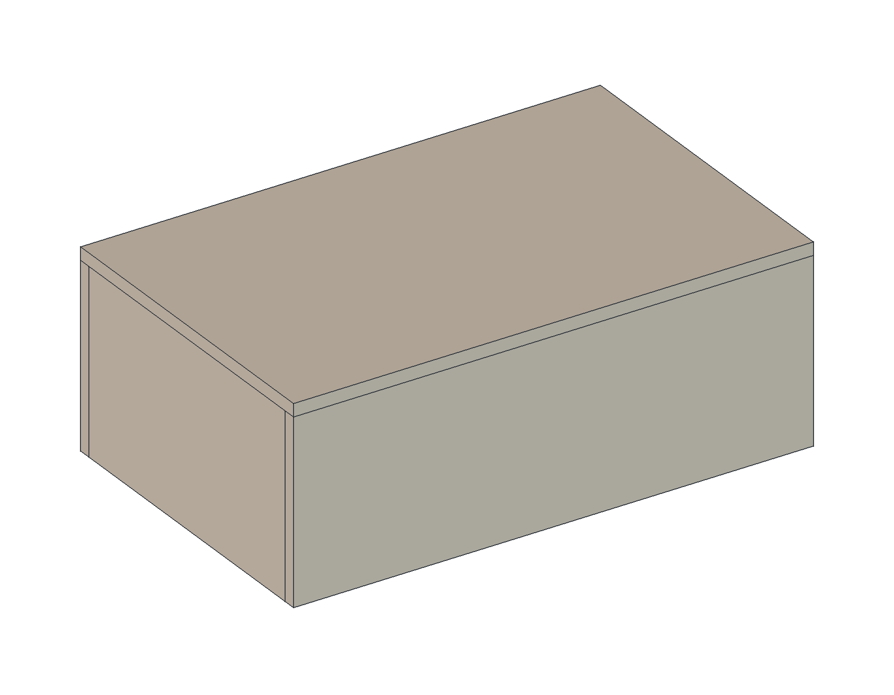
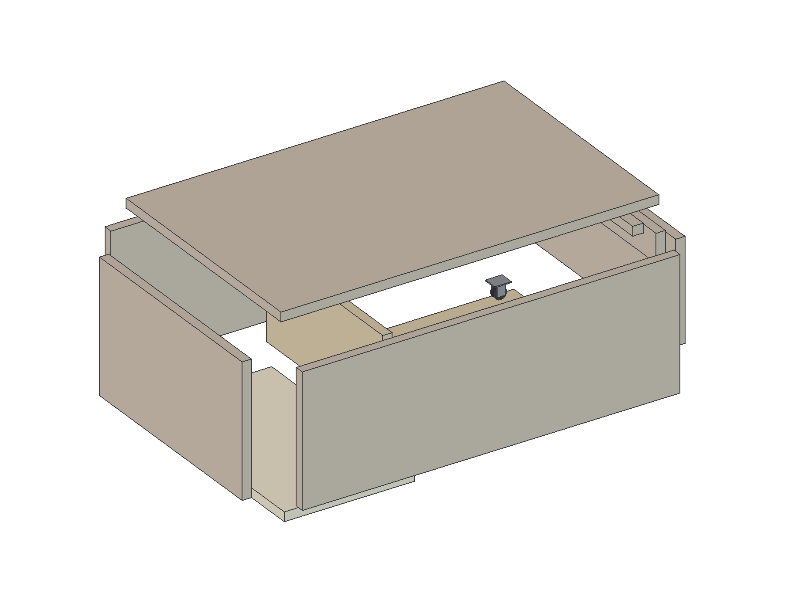

# Plywood drawer pulls — concealed ends

**Build one complete module, then move to the next.**

[Bed — module-by-module assembly PDF](workshop/bed/Module_by_Module.pdf) · [Cabinet — module-by-module assembly PDF](workshop/cabinet/Module_by_Module.pdf)

[Bed: individual module checklist](workshop/bed/modules/README.md) · [Cabinet: individual module checklist](workshop/cabinet/modules/README.md)

| Example: completed side drawer bay | Same bay — exploded construction |
| --- | --- |
|  |  |

Each module pack includes assembled / exploded / interior views, its own whole-mm parts targets and banding diagrams, build steps and a completion checklist. **Bed: 14 modules + final installation. Cabinet: 7 module groups + final installation.** Build that module's own drawers before moving on, subject to actual hardware fit. The TV centre and drawer tower share structure. Every plywood part appears once across the module packs; final site-fit scribes are assigned to installation.

Sheet nesting remains a separate cutting-batch plan: gather labelled parts from their stock sheets into each module kit. Rounded targets still require dry-fit; connector / wall-fixing patterns and hardware fit are not finalized by these guides.

Current models: **Bed_Wall_Unit_v9.FCStd** and **Bedroom_Cabinet_Modern_v9.FCStd**.

The user rejected exposed notch ends and drawer-style notches on cabinets that
contain only doors. This revision keeps the existing outside side/end panels
solid and ends each L/C channel against their inside faces. **No extra plywood
cover panels are added.**

| Drawer detail | Overall depth | Overall height | At 19.6 mm finished stock |
| --- | --- | --- | --- |
| Top L | 42 mm | 60 mm | One back and one lower return; 40.4 mm clear height |
| Intermediate C | 42 mm | 80 mm | One back and two returns; 40.8 mm clear height |

The L dimensions follow the reference. C height is a design allowance for the
plywood returns. Return width is 22.4 mm before final edge-band deductions.

## Drawer units only

- Bed nightstands: L at the top, C between the two drawers.
- Under-bed drawers: a single top L, ending between the existing sides or head/foot panels.
- Makeup cabinet drawer tower: L at the top, C between the three drawers.
- Fixed tops can have internal recess operations, but the outside sides stay intact.
- All fronts stay square-edged, with no angled pull cuts or aluminium grip rails.

## Plain door cabinets

Door-only cabinets have no L/C assemblies and no drawer-style side cutouts.
Where needed, plain rectangular shelves/bottoms stop 25 mm behind the front for
finger access to the square lower door edge. The makeup cabinet's tall-door pull
sides use a plain 25 mm front setback. No door overhang or new cover layer is added;
the door sizes and outside cabinet widths stay as before.

The wardrobe's internal drawers return to their original width and 400 mm runners.
The previous narrow drawer arrangement, mounting partition, and vertical plywood
channel assemblies are removed. The single makeup drawer keeps its accessible
lower square edge and 598.4 mm underside height.

The overhead dividers remain in both designs. Geometry and sampled drawer motion
are checked again, including verification that drawer channels exist only in drawer
units and that the visible side/end panels have no routed cutouts.

## Fabrication status

Finished stock is assumed to be 18 mm core + 0.8 mm laminate per face = 19.6 mm. The current native CutSchedule records all four band flags and separate blank/finished sizes. One-panel backboard, plinth strips, wheels and provisional lighting are in the current models; [workshop guide](WORKSHOP_GUIDE.md) and [lighting guide](LIGHTING_AND_WIRING.md) describe remaining hardware assumptions. Aluminium LED profiles are separate from these plywood grip channels.
