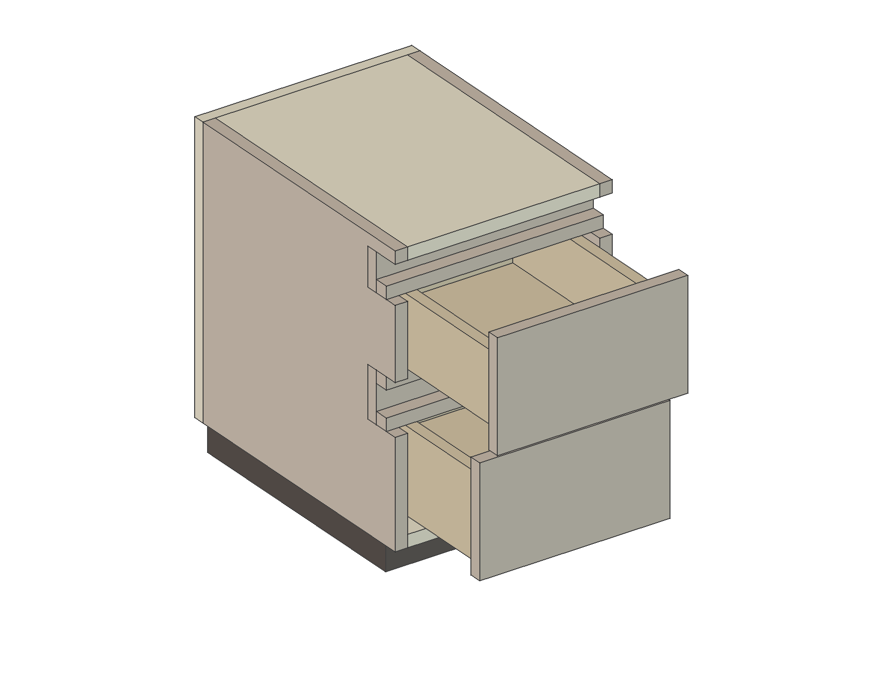
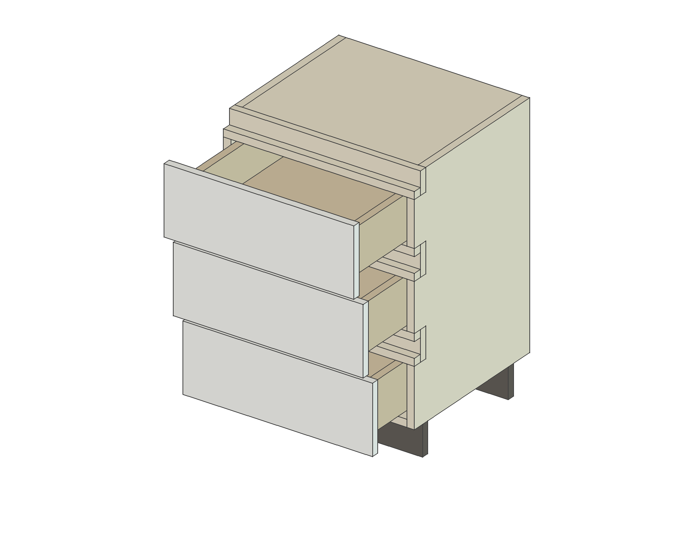

# Plywood handleless pull revision

Current FreeCAD files: **Bed_Wall_Unit_v5.FCStd** and
**Bedroom_Cabinet_Modern_v7.FCStd**. Earlier revisions remain available.

The user confirmed plywood construction: **L under the top, C between stacked
drawers, square-edged fronts, no angled finger-pull cuts and no aluminium grip rails**.

| Detail | Overall depth | Overall height | Construction at 19.6 mm finished stock |
| --- | --- | --- | --- |
| Top L | 42 mm | 60 mm | One back strip and one lower return; 40.4 mm clear height |
| Intermediate C | 42 mm | 80 mm | One back strip and two returns; 40.8 mm clear height |

The L envelope follows the user's dimensioned reference. The C height is a design
allowance for two plywood returns, not a dimension supplied in that reference.
Return blank width is 22.4 mm before final edge-band allowances.

The recesses use the existing 25 mm finger reveals. Their full heights extend
behind the fronts. The cabinet sides and intersecting fixed panels have actual
front-opening notches; they are not closed pockets hidden behind a solid side lip.
Each back and return is a separate part in the cut list. Routed panels retain their
blank dimensions and are marked with the required recess operation.

## Bed frame with cabinets

- Each nightstand has a top L and an intermediate C.
- Each under-bed drawer has a single top L.
- Upper side doors and overhead doors have a downward-opening lower L recess.
- All doors and drawer fronts have square edges. The bridge's three dividers remain.
- Drawer box heights/bottom elevations clear the fixed channel returns during travel.
- The separate 1-inch-wheel conversion is still pending hardware/rolling-surface details.

## TV and makeup cabinet

- The three-drawer tower has a top L and two intermediate C channels.
- The tall doors have vertical plywood pull recesses on their centre-facing edges.
- Wardrobe internal drawers are 60 mm narrower, with a runner mounting partition,
  so they pass beside the vertical recess. They use 350 mm runners.
- Drawer tower boxes have reduced heights and adjusted bottom elevations to clear
  both the upper and lower returns throughout travel; the tower retains 400 mm runners.
- Top-box doors have lower L recesses. The centre divider is retained.
- The single makeup drawer keeps its square lower pull edge accessible from the
  knee space. Its existing 598.4 mm underside height is unchanged.

The 19.6 mm finished stock assumption remains 18 mm plywood plus 0.8 mm laminate
per face. Measure the actual stock before fabrication. Per-edge band deductions,
the remaining material inconsistencies, headboard panel splitting, lighting, and
final optimized nesting remain separate audit work. Joining/fixing details and any
remaining fabrication allowances must be reviewed before cutting.
