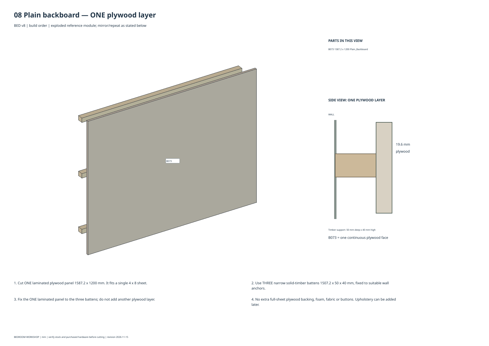
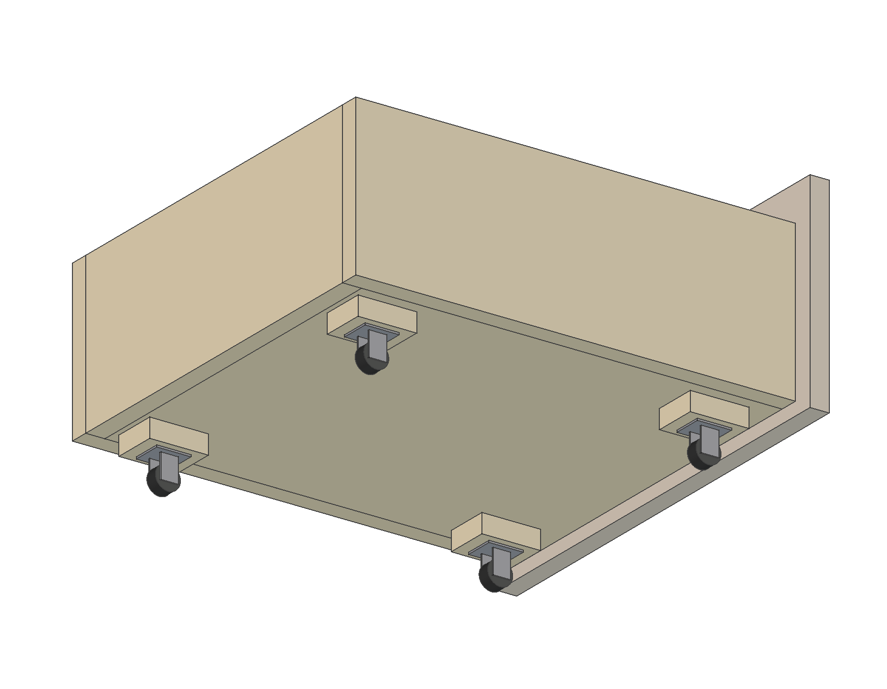

# Bedroom projects — start here

**[OPEN THE FILE INDEX — all relevant files](START_HERE.md)**

Click your project's picture or **BUILDING MANUAL** below. The first module is on page 2, after the preparation page.

| Bed frame + surrounding cabinets | TV + makeup + wardrobe cabinet |
| --- | --- |
|  |  |
| **[1. BUILDING MANUAL — START HERE](workshop/bed/Assembly_Manual.pdf)** | **[1. BUILDING MANUAL — START HERE](workshop/cabinet/Assembly_Manual.pdf)** |
| [2. CUTTING SHEETS](workshop/bed/Cutting_Layouts.pdf) | [2. CUTTING SHEETS](workshop/cabinet/Cutting_Layouts.pdf) |
| [3. LED WIRING DIAGRAM](workshop/bed/LED_Wiring.pdf) | [3. LED WIRING DIAGRAM](workshop/cabinet/LED_Wiring.pdf) |
| [4. OPEN FREECAD MODEL v8](Bed_Wall_Unit_v8.FCStd) | [4. OPEN FREECAD MODEL v9](Bedroom_Cabinet_Modern_v9.FCStd) |

**FreeCAD update — every drawer is grouped inside its cabinet module.**

| Bed: isolate one drawer | Makeup cabinet: isolate one drawer |
| --- | --- |
|  |  |

Select a module or drawer → **Macro → Macros… → Bedroom_Isolate_Module → Execute** → **SHOW ONLY SELECTED**. Use **RESTORE PREVIOUS VIEW** to return. [Picture instructions](WORKSHOP_GUIDE.md#work-on-one-module-or-drawer).

**Shopping source: Shopee Philippines.** Hardware fit is still being checked; **4 wardrobe hinges and 2 wardrobe slide pairs are on hold**.

**Backboard update — ONE plywood panel; upholstery deferred.**

[Detailed shopping list](MATERIALS_LIST.md) · [Shopping spreadsheet / CSV](materials_purchase_summary.csv)

More current cabinet views — lights, wheels and interiors

[All current cabinet screenshots](screenshots/README.md)

