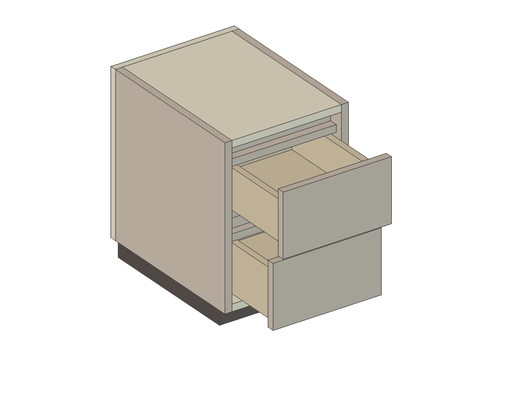
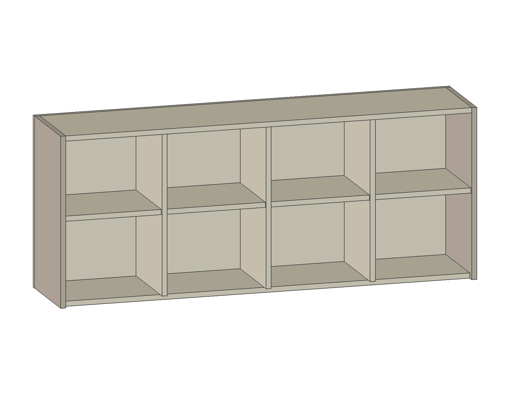

# Bedroom cabinet and bed frame

## Latest approved design — bed v6 and makeup cabinet v8

Updated screenshots are embedded here after every major design change, and in the session notes.

Bed frame with cabinets — full design:

TV/makeup cabinet — full design:

Bed cabinet drawer detail — solid sides and concealed L/C ends:

Makeup cabinet drawer detail — solid sides and concealed L/C ends:

---

Two separate FreeCAD furniture designs, reviewed on CachyOS with FreeCAD 1.1.4.
Latest major design update: **2026-11-15 — solid channel ends; drawer-only L/C pulls**.

| Project | Current model | Cut list |
| --- | --- | --- |
| Bed frame with side and overhead cabinets | [Bed v6](Bed_Wall_Unit_v6.FCStd) | [Bed cut list](cut_list_bed_v6.csv) |
| Cabinet with makeup table and TV | [Cabinet v8](Bedroom_Cabinet_Modern_v8.FCStd) | [Cabinet cut list](cut_list_v8.csv) |

## Bed frame with cabinets — v6

The drawer grips are built from laminated plywood: **L under the top and C between
stacked drawers**. The channels stop between the existing solid sides, so their ends
are concealed without extra cover panels. Door-only cabinets have no L/C cutouts.
All fronts retain square, edge-banded edges.

The four-door overhead cabinet now has **three full-height dividers**, one
compartment behind each door, and four separate shelf panels. Shelf widths are
368.9 / 378.7 / 378.7 / 368.9 mm, replacing the former 1554 mm span.
The outside dimensions and existing door sizes are preserved.

### Overhead cabinet detail — doors hidden

### Front view

### Cabinet interiors — doors and mattress hidden

[Build script](build_bed_v6.py) · [Three-sheet drawing](Bed_Wall_Unit_v6_Drawing.FCStd)
· [Drawing script](build_bed_drawing_v6.py) · [Hardware list](hardware_bed_v6.csv)

## Cabinet with makeup table and TV — v8

The drawer tower has a plywood **L recess at the top and C recesses between drawers**.
The channels stop at the inside faces of the existing side panels; their ends do
not cut through the visible sides. L/C channels are restricted to drawer units.
Door-only units have plain panels and simple setbacks for finger access.

A **centre divider** now separates the two-door top box above the TV. Each side
top box already has its own compartment. Outside dimensions and door sizes are
preserved, including the 720 mm makeup table and 1650 mm hanging rail.

### Top cabinet detail — doors hidden

### Front view

### Cabinet interiors — doors hidden

[Build script](build_cabinet_v8.py) · [Plywood pull parts and routing](plywood_pull_parts.csv)

## Current design review and next revision

[Detailed design audit](DESIGN_REVIEW.md) · [Screenshot gallery](screenshots/README.md)

The L recess is 42 mm deep × 60 mm high, following the reference. The C recess
is 42 mm deep × 80 mm high, with 40.8 mm clear between 19.6 mm returns. Drawer
boxes were resized to clear the fixed channels. Wardrobe internal drawers return to their original width and 400 mm runners;
the extra mounting partition from the previous revision is removed.
The single makeup drawer keeps its accessible lower square pull edge.

[Cabinet hardware list](hardware_cabinet_v8.csv) · [Plywood pull construction](PLYWOOD_PULLS.md)

Both saved revisions pass geometry and sampled drawer-travel checks. Earlier models remain available for
comparison. The following requests are recorded for the next revision:

- Use 3/4-inch plywood laminated on both faces, with edge banding. Reconcile
  older raw-panel thicknesses and verify the actual stock dimensions.
- Replace runners on the six under-bed drawers with 1-inch-diameter wheels.
  The rolling surface, wheel type, and total mounting height still need confirmation;
  the screenshots above still show the drawer design before this conversion.
- Add the required strip-light profiles, cable routes, and accessible driver space
  after confirming the lighting locations.
- Correct oversized headboard panels, composite
  plinth entries and edge-band allowances before final fabrication.
- Produce CutList Optimizer-style sheet diagrams with labelled parts, cutting
  dimensions, kerf, trim, edge banding, material utilization, and offcuts.

Current cut CSVs are reference lists; final optimized cutting layouts are pending
the remaining design corrections. The combined bedroom layout's empty links also
remain to be repaired.

**After every major design change, update both the session notes and this GitHub
README with fresh screenshots of each affected design.**
