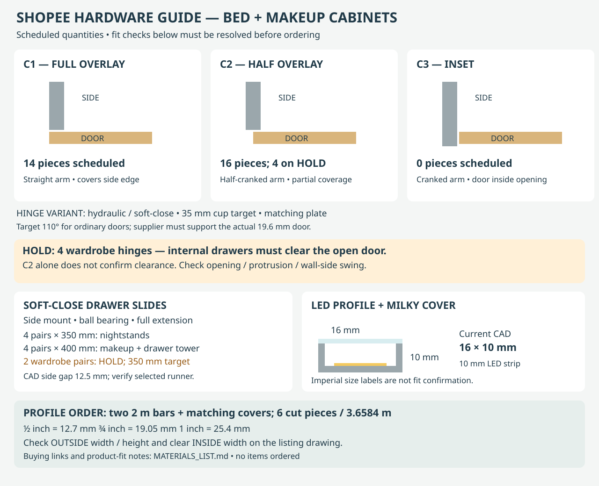
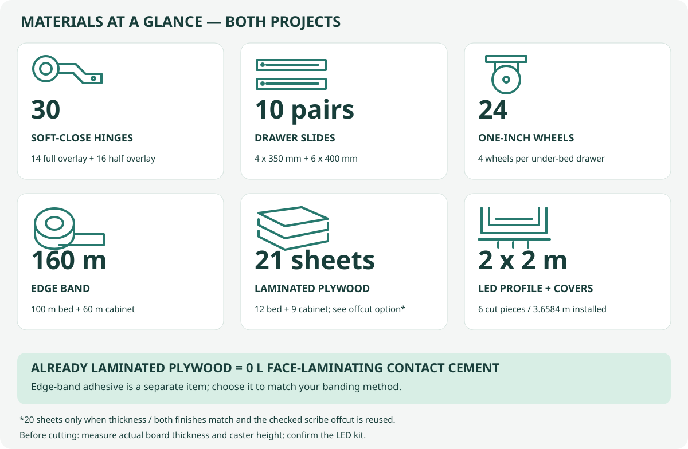
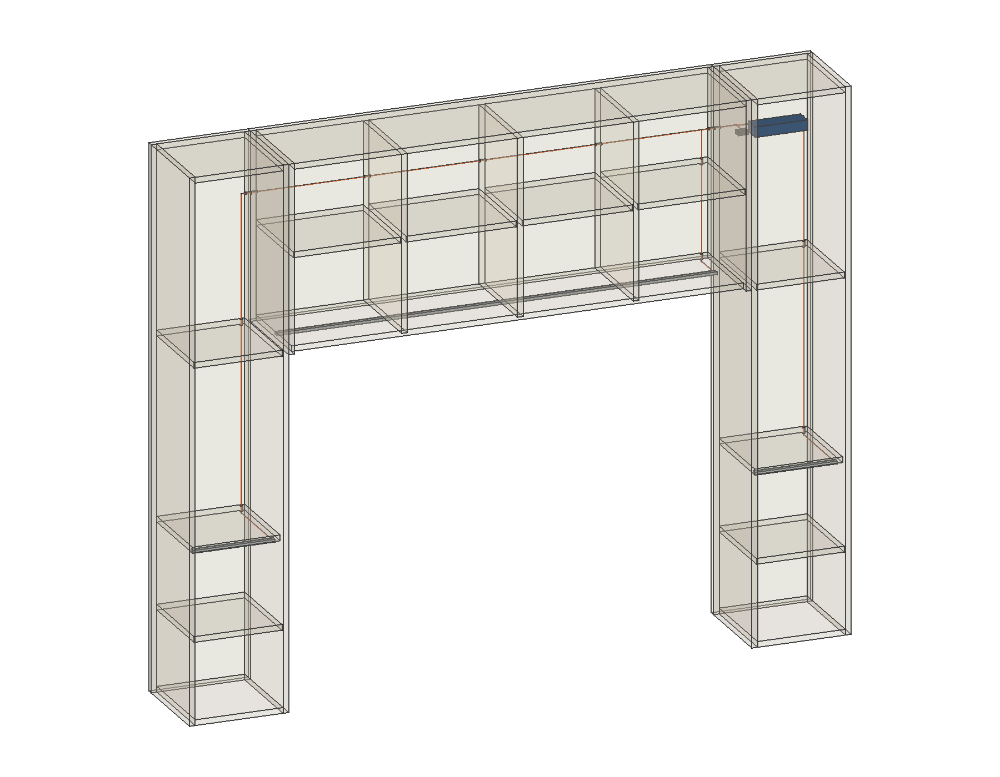
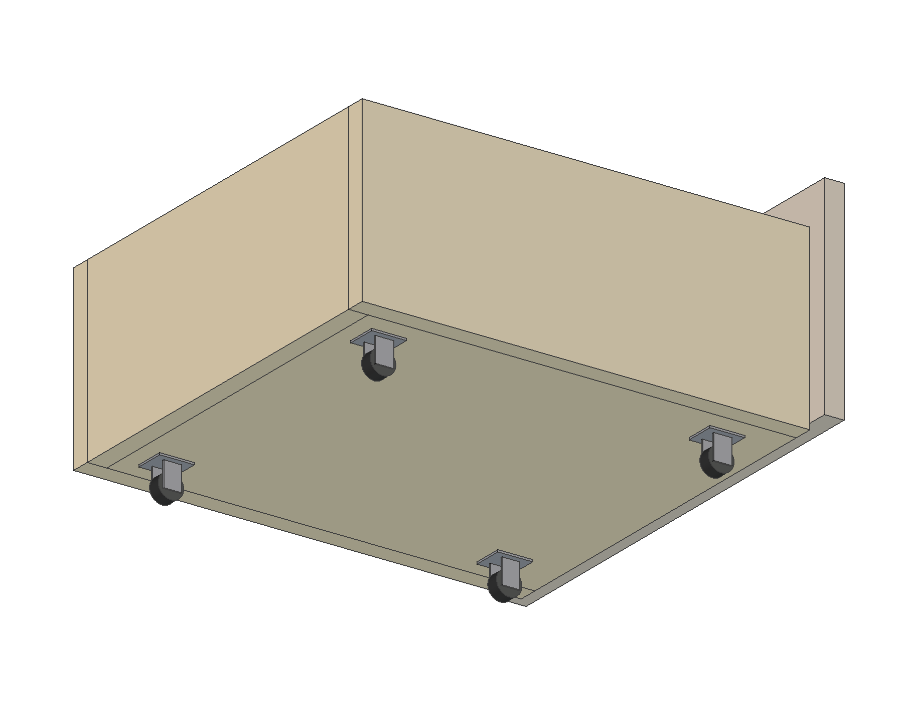

# Bedroom projects — start here

**Updated 2026-11-17 — bed v9: wheels mount directly under the drawer bottoms.** All 24 plywood wheel pads are removed. The six drawer bottoms are 19.6 mm lower, with taller sides/backs; fronts and travel stay in place. Wheel diameter is 25.4 mm; the assumed 35 mm overall mounting height and actual fixings still need checking.

| Current bed v9 — full design | TV / makeup / wardrobe v9 — current design |
| --- | --- |
|  |  |

| Direct wheel plate mounting — cropped underside detail | Bed v9 drawers open — interior and travel |
| --- | --- |
|  |  |

**Readable cut lists:** A4 landscape, 12-point tables, separate numbered maps, complete parts tables and saw steps. Print at **100% / actual size**. The layout includes **4 mm kerf** and **5 mm trim per sheet edge**.

[Bed cutting PDF](workshop/bed/Cutting_Layouts.pdf) · [Cabinet cutting PDF](workshop/cabinet/Cutting_Layouts.pdf) · [Bed v9 model](Bed_Wall_Unit_v9.FCStd) · [Bed v9 drawings](Bed_Wall_Unit_v9_Drawing.FCStd)

| Bed — larger parts table | Cabinet — larger parts table |
| --- | --- |
|  |  |

For the same readable pages inside FreeCAD, open [bed cutting pages](workshop/bed/Readable_Cutting.FCStd) or [cabinet cutting pages](workshop/cabinet/Readable_Cutting.FCStd). The bed v9 main model also contains the new cutting pages. [Earlier bed v8 pack — history](workshop/history/bed_v8_before_direct_mount/README.md).

**[OPEN THE FILE INDEX — all relevant files](START_HERE.md)**

Click your project's picture or **BUILDING MANUAL** below. The first module is on page 2, after the preparation page.

| Bed frame + surrounding cabinets | TV + makeup + wardrobe cabinet |
| --- | --- |
|  |  |
| **[1. BUILDING MANUAL — START HERE](workshop/bed/Assembly_Manual.pdf)** | **[1. BUILDING MANUAL — START HERE](workshop/cabinet/Assembly_Manual.pdf)** |
| [2. CUTTING SHEETS](workshop/bed/Cutting_Layouts.pdf) | [2. CUTTING SHEETS](workshop/cabinet/Cutting_Layouts.pdf) |
| [3. LED WIRING DIAGRAM](workshop/bed/LED_Wiring.pdf) | [3. LED WIRING DIAGRAM](workshop/cabinet/LED_Wiring.pdf) |
| [4. OPEN FREECAD MODEL v9](Bed_Wall_Unit_v9.FCStd) | [4. OPEN FREECAD MODEL v9](Bedroom_Cabinet_Modern_v9.FCStd) |

**FreeCAD update — every drawer is grouped inside its cabinet module.**

| Bed: isolate one drawer | Makeup cabinet: isolate one drawer |
| --- | --- |
|  |  |

Select a module or drawer → **Macro → Macros… → Bedroom_Isolate_Module → Execute** → **SHOW ONLY SELECTED**. Use **RESTORE PREVIOUS VIEW** to return. [Picture instructions](WORKSHOP_GUIDE.md#work-on-one-module-or-drawer).

**Shopping source: Shopee Philippines.** Hardware fit is still being checked; **4 wardrobe hinges and 2 wardrobe slide pairs are on hold**.

**Backboard update — ONE plywood panel; upholstery deferred.**

[Detailed shopping list](MATERIALS_LIST.md) · [Shopping spreadsheet / CSV](materials_purchase_summary.csv)

Lighting references — unchanged arrangement from the previous revision

[All current cabinet screenshots](screenshots/README.md)

