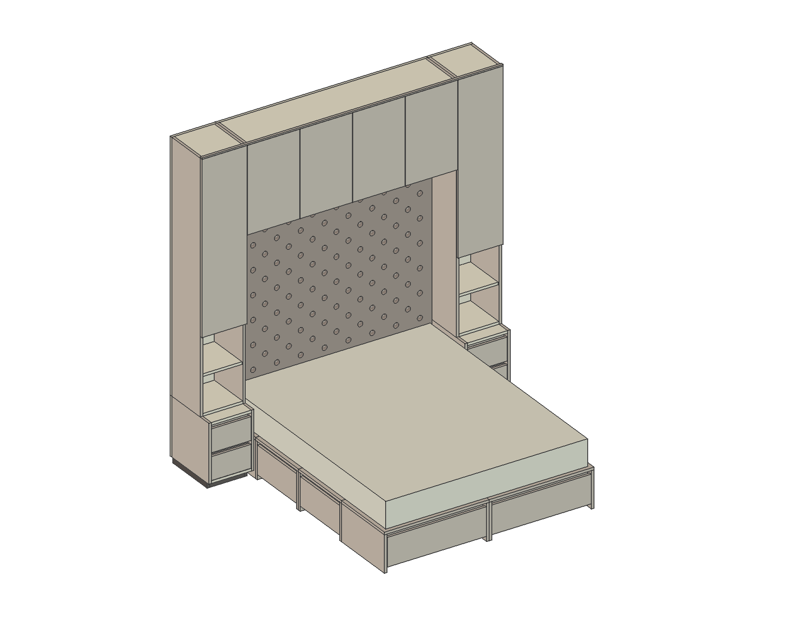
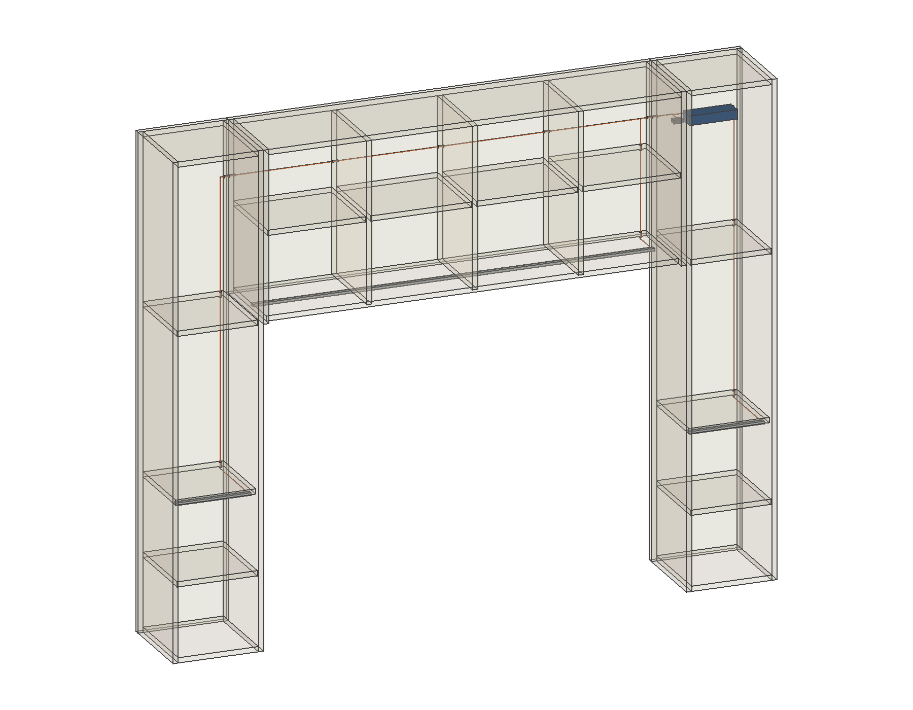
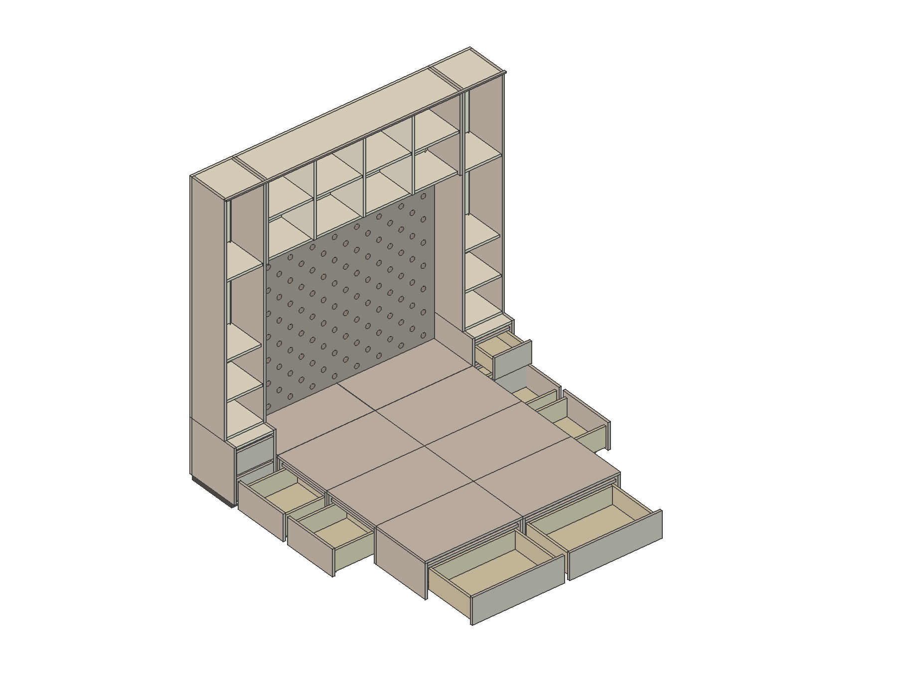
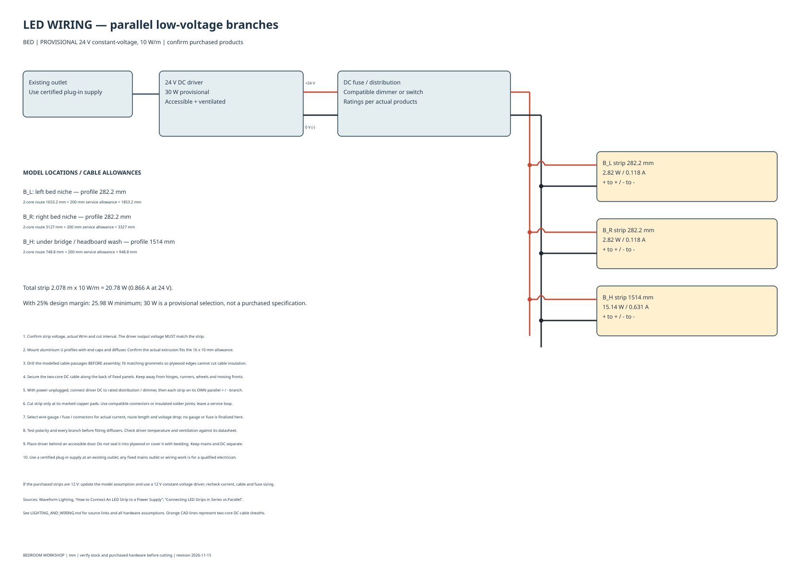
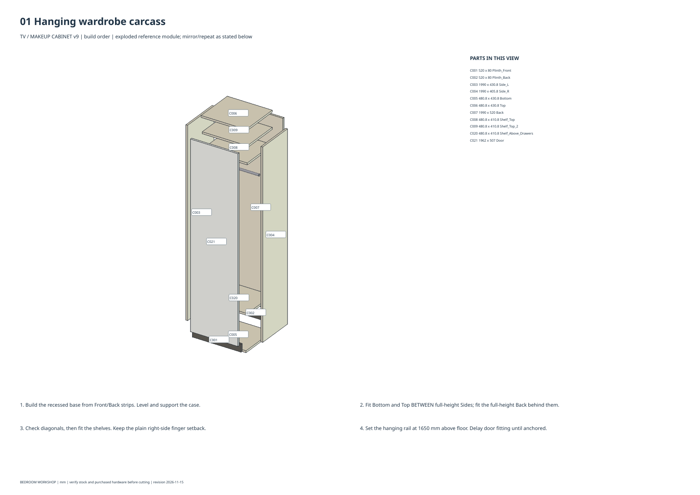
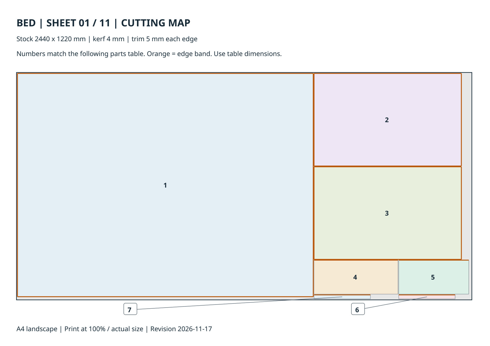
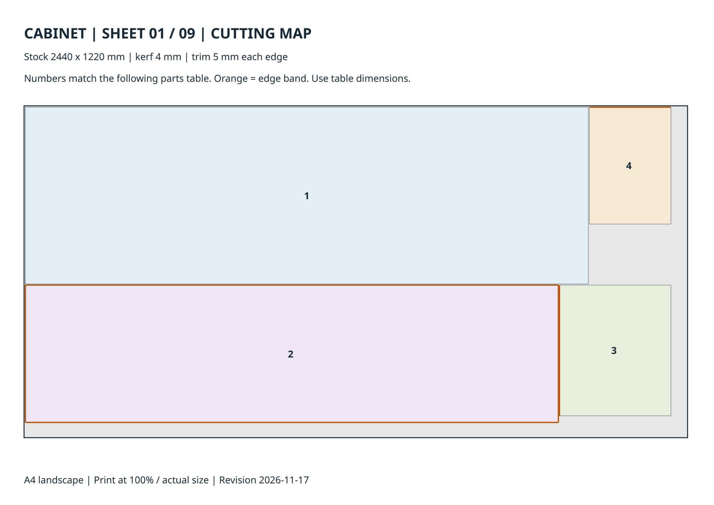
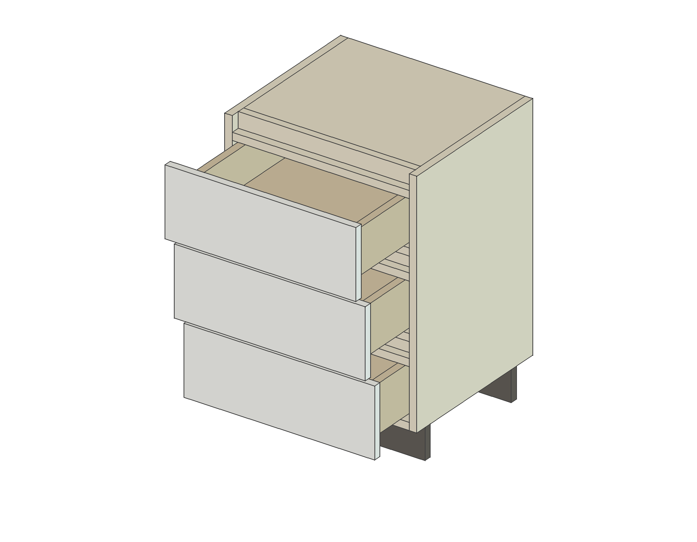

# Bedroom furniture — bed v7 and TV/makeup cabinet v9

Latest design update: **2026-11-15 — 1-inch wheel drawers, aluminium LED profiles and wiring, native cutting layouts, illustrated module manuals**.

Bed frame and surrounding cabinets — full design:

TV / makeup / wardrobe cabinet — full design:

Bed lighting — profiles, cable routes and driver (panels transparent):

Makeup lighting — profiles, cable routes and driver (panels transparent):

Under-bed drawer — four 1-inch wheels, viewed from below:

Bed drawers open — wheel travel and room clearances:

## Current files

| Project | FreeCAD model with cutting and assembly pages | Cutting PDF | Illustrated assembly PDF |
| --- | --- | --- | --- |
| Bed with surrounding cabinets | [Bed v7](Bed_Wall_Unit_v7.FCStd) | [12 stock sheets](workshop/bed/Cutting_Layouts.pdf) | [12-page manual](workshop/bed/Assembly_Manual.pdf) |
| TV / makeup / wardrobe cabinet | [Cabinet v9](Bedroom_Cabinet_Modern_v9.FCStd) | [9 stock sheets](workshop/cabinet/Cutting_Layouts.pdf) | [9-page manual](workshop/cabinet/Assembly_Manual.pdf) |

Inside each model, expand **Workshop Documents** and open **Sheet 01** (`Cutting_01`), **CutSchedule**, **SawCuts**, **SheetSummary**, **Offcuts** or **Materials**. Expand **Assembly Manual** for numbered module pages and **LED Wiring**. Panel IDs B001… / C001… match the 3D parts, cutting diagrams and module illustrations.

[Cutting and building guide](WORKSHOP_GUIDE.md) · [LED locations and wiring](LIGHTING_AND_WIRING.md) · [Bed wiring PDF](workshop/bed/LED_Wiring.pdf) · [Cabinet wiring PDF](workshop/cabinet/LED_Wiring.pdf).

[Combined materials and hinge breakdown](MATERIALS_LIST.md) · [Shopping CSV](materials_purchase_summary.csv). Current schedules: **30 soft-close hinges (14 full / 16 half overlay), 10 slide pairs, 24 one-inch wheels, 160 m rounded edge-band order, and 6 LED-profile pieces cut from two 2 m bars with covers**. Plywood is 21 sheets in separate layouts, or 20 only with the matching-finish shared-offcut option. Contact-cement litres await lamination method and actual product coverage.

## Strip lighting and aluminium profiles

Both models now contain separate aluminium U-profile, LED strip and diffuser parts, accessible driver/distribution spaces, two-core DC cable routes, and cable passages through fixed plywood panels. Bed lighting: both niches and under the bridge. Makeup lighting: both sides of the mirror and under the TV ledge. The previous bed puck placeholders are replaced by strip lighting.

Wiring: existing outlet → certified plug-in constant-voltage driver → rated DC fuse/distribution and compatible dimmer → separate **parallel** positive/negative branches. The diagram shows polarity, branch labels, loads and cable allowances. Driver access is through the left upper bed cabinet and left top box of the makeup cabinet. Aluminium LED profiles are separate from the **plywood L/C drawer grips**.

**Lighting hardware is provisional:** 24 V, 10 W/m strip; 16 × 10 mm profile envelope; one 30 W driver per project. Actual strip voltage, W/m, cut interval, ventilation, grommets, conductor/fuse ratings and the outlet location must be confirmed. Any new fixed mains work needs a qualified electrician. See the [wiring guide and manufacturer sources](LIGHTING_AND_WIRING.md).

Bed LED wiring diagram:

Makeup cabinet LED wiring diagram:

## What to build first

Bed: **head lift-up boxes → four side drawer bays → two foot bays → six wheeled drawers → joined bed platform → nightstands → upper cabinets → headboard → bridge → final fit and lighting**.

TV/makeup cabinet: **hanging wardrobe → shelf tower → drawer-tower case and grips → centre back/table/shelves → drawer boxes → top boxes with divider → mirror, lights and doors**.

Each manual page shows the actual model parts with matching panel IDs and assembly actions. Supplier-specific fastener/hinge drilling and wall fixings remain dependent on the selected hardware and wall. The pack does not claim a furniture load rating.

Bed module manual — build the two head boxes first:

Makeup cabinet module manual — wardrobe case first:

## CutList Optimizer-style layouts inside FreeCAD

The bed has **207 plywood panels on 12 sheets**; the TV/makeup cabinet has **97 panels on 9 sheets**, nested separately. Pages include panel IDs/dimensions, band marks, stock outline, utilization, kerf, trim and offcuts. The native spreadsheets include the guillotine cut sequence and individual panel schedule. The achieved layout is a 24-trial heuristic, not a guarantee of the minimum possible sheet count.

Assumptions: **2440 × 1220 mm stock; 5 mm edge trim; 4 mm kerf; 1 mm edge band; 18 mm core + 0.8 mm laminate each face = 19.6 mm finished**. Measure the actual material. Finished and blank dimensions are separate; blank sizes deduct only the flagged banded edges. Rotation is allowed for plain laminate; set `AllowRotation = 0` for directional grain and regenerate.

[Bed panel schedule](workshop/bed/CutSchedule.csv) · [Cabinet panel schedule](workshop/cabinet/CutSchedule.csv). Edit native **CuttingSettings** and **CutSchedule** band flags, then run [regenerate_workshop.FCMacro](regenerate_workshop.FCMacro); save and [refresh PDF exports](export_workshop.FCMacro). Pages do not repack automatically on a cell edit.

Bed stock sheet example:

Makeup cabinet stock sheet example:

Cutting layout open inside FreeCAD:

## Bed wheel conversion and retained approved details

The six under-bed drawers have **four fixed-direction 25.4 mm wheels each (24 total)**, plywood mounting pads, short lateral guides and removable retention straps in the hardware schedule. They run on the room floor, with no raised full bay floor obstructing them. Side travel remains 337 mm and foot travel 450 mm. **Total caster mounting height is assumed 35 mm; it is not the wheel diameter.** Measure the purchased caster, floor and load capacity before cutting wheel-dependent parts. Nightstand runners remain 350 mm; the six TV/makeup/wardrobe runner pairs remain 400 mm.

The headboard backing and upholstery substrate are split into sheet-sized halves; nightstand plinths are actual four-strip rings. All furniture plywood uses the same two-face-laminated thickness assumption. Adjacent head lift-up lids have a 3 mm gap. Foot clearance is now 518.4 mm (68.4 mm with a foot drawer fully open); that remaining gap is not walking space.

Plywood L under the top and C between drawers remains, with concealed ends between solid outside sides. No extra cover plywood, door-only drawer notches or 45-degree bevels. The overhead dividers remain. The table stays 720 mm high; drawer underside 598.4 mm still does not admit the chair's 630 mm armrests.

Bed plywood L/C pulls — concealed ends:

Makeup plywood L/C pulls — concealed ends:

[Three-sheet bed drawing](Bed_Wall_Unit_v7_Drawing.FCStd) · [Bed hardware](hardware_bed_v7.csv) · [Cabinet hardware](hardware_cabinet_v9.csv) · [Design review](DESIGN_REVIEW.md) · [Full screenshot gallery](screenshots/README.md) · [Plywood pull details](PLYWOOD_PULLS.md).

Validation: valid saved solids; closed furniture and sampled drawer-travel checks; 24 floor-tangent wheels; LED/furniture clearances; panel completeness, stock bounds and kerf separation; embedded native SVG pages; PDF page counts. Earlier bed v6/cabinet v8 files remain unchanged. These checks do not validate unselected hardware or structural/thermal performance. The old combined `Bedroom_Layout.FCStd` still has broken links; use the two current standalone models.

Rebuild using [build_workshop.FCMacro](build_workshop.FCMacro); sources: [bed](build_bed_v7.py), [cabinet](build_cabinet_v9.py), [cutting layouts](workshop_documents.py), [assembly pages](assembly_manual.py), [lighting](cabinet_lighting.py), [wheel drawers](bed_wheel_drawers.py).

**After every major design change: refresh screenshots at the start of both READMEs and the authoritative session, then publish the README, images and models to GitHub.**
