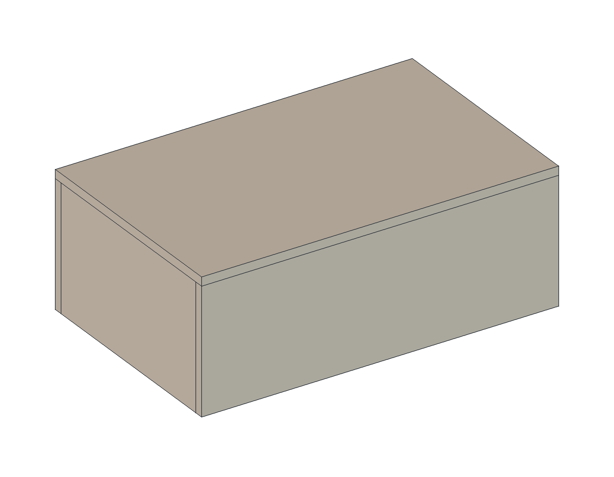
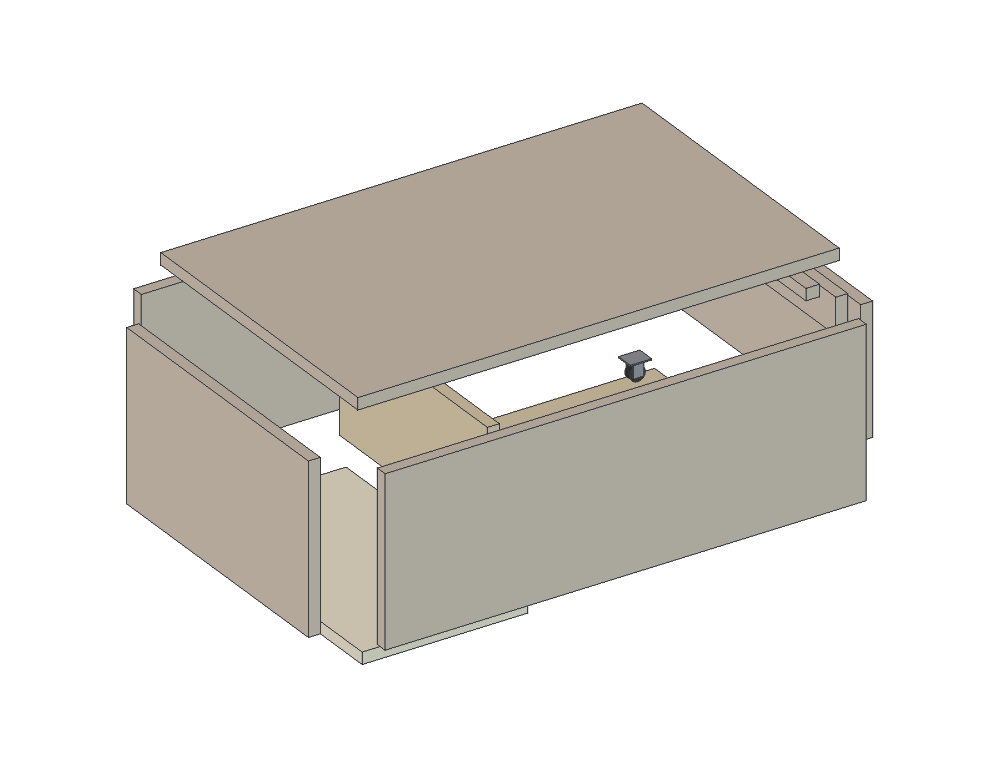
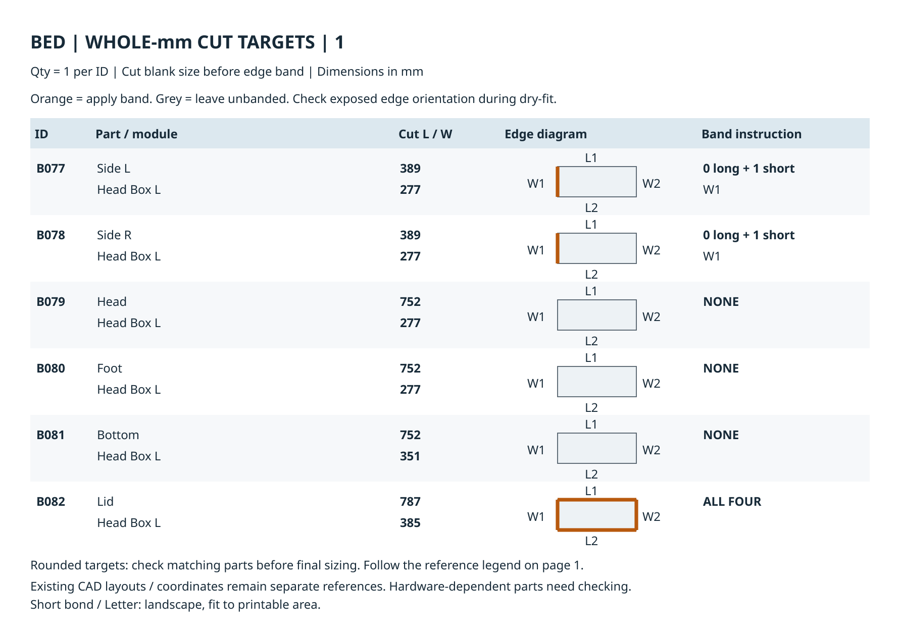
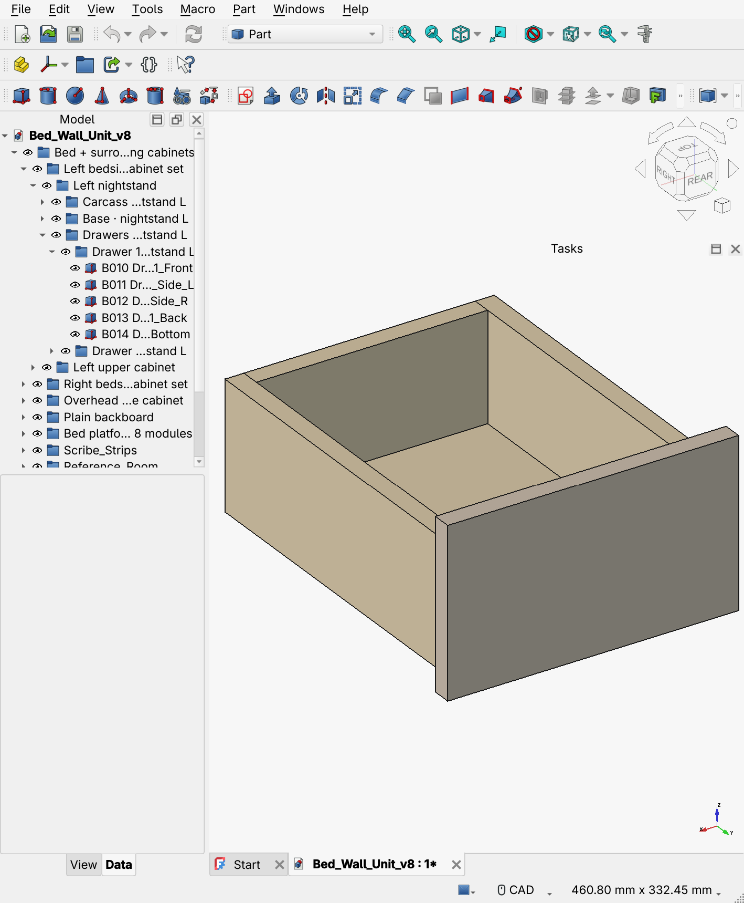
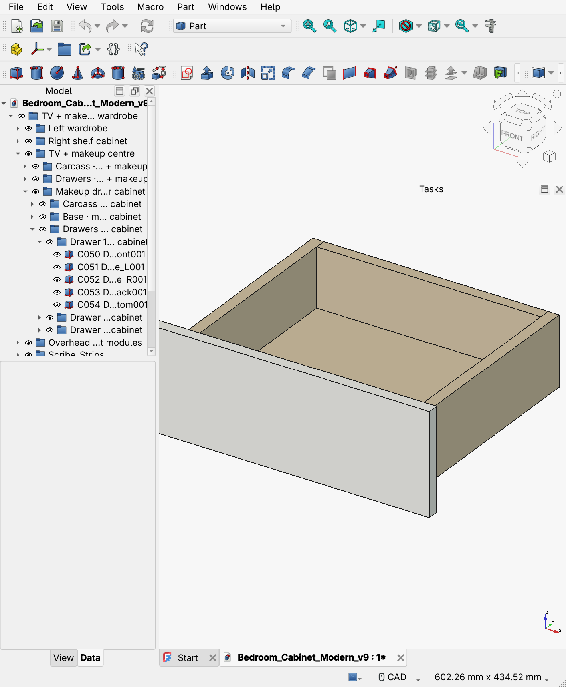
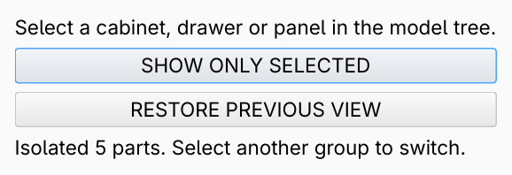

# Cutting layouts and module assembly pack

**Build one complete module, then move to the next.**

[Bed — module-by-module assembly PDF](workshop/bed/Module_by_Module.pdf) · [Cabinet — module-by-module assembly PDF](workshop/cabinet/Module_by_Module.pdf)

[Bed: individual module checklist](workshop/bed/modules/README.md) · [Cabinet: individual module checklist](workshop/cabinet/modules/README.md)

| Example: completed side drawer bay | Same bay — exploded construction |
| --- | --- |
|  |  |

Each module pack includes assembled / exploded / interior views, its own whole-mm parts targets and banding diagrams, build steps and a completion checklist. **Bed: 14 modules + final installation. Cabinet: 7 module groups + final installation.** Build that module's own drawers before moving on, subject to actual hardware fit. The TV centre and drawer tower share structure. Every plywood part appears once across the module packs; final site-fit scribes are assigned to installation.

Sheet nesting remains a separate cutting-batch plan: gather labelled parts from their stock sheets into each module kit. Rounded targets still require dry-fit; connector / wall-fixing patterns and hardware fit are not finalized by these guides.

**Manual cutting sheets updated — whole-mm targets with an edge-banding diagram for every part.**

[Bed manual cut sheet](workshop/bed/Manual_Whole_mm.pdf) · [Cabinet manual cut sheet](workshop/cabinet/Manual_Whole_mm.pdf) · [Edge-banding instructions](EDGE_BANDING_GUIDE.md)

**Do not band every edge.** Orange marks show the scheduled banding; **NONE** means no band and **ALL FOUR** means every edge. The new sheets reproduce existing CAD band flags; exposure/orientation still needs checking during dry-fit. Whole-mm targets are rounded references, not a checked redesign; the original CAD saw coordinates are separate.

Current models: **Bed_Wall_Unit_v9.FCStd** and **Bedroom_Cabinet_Modern_v9.FCStd**. Their native FreeCAD pages contain the cutting layouts, illustrated module build order and LED wiring diagram. PDFs and CSVs are in `workshop/bed/` and `workshop/cabinet/`.

## Work on one module or drawer

The saved models use **cabinet module → drawers → individual drawer → panels**. Bed: 14 modules / 10 drawers; TV/makeup: 7 modules / 6 drawers. A normal drawer group contains its five plywood panels. Each under-bed drawer also contains its four wheel assemblies; its fixed bay and grip channel remain with the cabinet case.

| Bed tree | TV / makeup tree |
| --- | --- |
|  |  |

1. Open the 3D model tab and select the cabinet or drawer folder in the tree.
2. Open **Macro → Macros…**, select **Bedroom_Isolate_Module**, then **Execute**. It is installed in this computer's FreeCAD macro directory. The source is [Isolate_Module.FCMacro](Isolate_Module.FCMacro); its project path must be adjusted if this project is moved to another computer.
3. Click **SHOW ONLY SELECTED**. Select a different folder and click again to switch.
4. Click **RESTORE PREVIOUS VIEW**, or close the tool, to restore the previous visibility and camera. Restore before saving if you want the complete cabinet visible next time.

These are organizational groups; they do not impose assembly constraints or certify that every section is independently removable. The TV/makeup centre shares its back and table structure. Grouping does not change panel dimensions, part IDs, cutting layouts, hardware quantities or furniture placements.

## Open the cut layouts inside FreeCAD

**Readable A4 edition (2026-11-17):** Open `workshop/bed/Readable_Cutting.FCStd` or `workshop/cabinet/Readable_Cutting.FCStd`. Each sheet has a numbered cutting map, parts pages (11 rows per page) and saw-step pages (16 steps per page). All body text is at least 12.2 pt at actual-size A4 landscape. Part numbers on each map match the following table; IDs remain Bxxx/Cxxx. Every part is listed, including crowded sheets. Both `Cutting_Layouts.pdf` files use these readable pages. Original A3 exports are retained in `workshop/history/before_readability_2026-11-17/`.

**Bed v9 direct wheel mounting:** Four wheel plates attach directly under each 19.6 mm drawer bottom. There are no plywood wheel pads. Bottom undersides move from 54.6 mm to 35 mm above the floor; the 18 sides/backs grow 19.6 mm taller, and the short fixed guides move down 19.6 mm. Drawer fronts, rolling direction and travel remain as before. The 35 mm bracket height is provisional. Check the actual plate and fixings before cutting drawer parts or drilling. v8 and its pack remain available as history.

1. Open the relevant model.
2. In the readable companion, expand **Workshop Documents** and open the numbered map, parts and saw pages for each sheet. The bed v9 main model also contains these pages.
3. Open **CutSchedule** for every panel's ID, module, quantity, finished dimensions, band flags, blank dimensions and assigned sheet. Each row is one physical panel.
4. **SawCuts** gives the guillotine cutting sequence, stock coordinates, cut span and parent rectangle bounds. Trim the stock first, keep the X/Y origin marked and follow each sheet's steps in order. Dimensions are not inferred from the screen scale.
5. **SheetSummary** shows actual achieved sheet count/use, offcut area, trim and kerf/sliver area; **Offcuts** records rectangular remainders. **Materials** shows the corresponding sheet and edge-band quantities; **Hardware** retains the hardware schedule.

The layouts provide the requested CutList Optimizer-style stock diagrams, labels, dimensions, quantities, kerf, trim, edge-banding marks and remainders. They use a 24-trial guillotine heuristic for each project separately. **The achieved sheet count is not a guarantee of the mathematical minimum**, and the two projects have not been combined into one mixed cutting batch. Do not add a generic 25% waste allowance on top of the shown sheet count.

| Project | Individual plywood panels | Stock sheets in this layout | Net edge band | Band with 10% trim allowance |
| --- | ---: | ---: | ---: | ---: |
| Bed and surrounding cabinets | 180 | 11 | 92.727 m | 101.999 m |
| TV / makeup / wardrobe cabinet | 97 | 9 | 52.414 m | 57.656 m |

The backboard is one 1587.2 x 1200 x 19.6 mm plywood panel on three narrow 1507.2 x 50 x 40 mm solid-timber battens. Extra plywood, foam and fabric are removed; upholstery is deferred. The nightstand plinths are four-strip rings, not solid blocks. All recorded furniture plywood now uses the same two-face-laminated stock assumption.

## Cutting assumptions and editing

- Nominal 3/4-inch plywood is assumed **18 mm core + 0.8 mm laminate per face = 19.6 mm finished**. Measure the actual supplied board. The model does not assume a literal 19.05 mm core.
- Stock **2440 × 1220 mm**, trim **5 mm each edge**, saw kerf **4 mm**, finished edge band **1 mm**. Band width must cover the finished board thickness.
- Model dimensions are **finished sizes**. Blank Length deducts band thickness at W1/W2; blank Width deducts it at L1/L2. Orange marks identify banded edges. Review defaults against the actual exposed edges before cutting.
- Plain laminate permits rotation by default. For directional grain, set `AllowRotation` to 0; long panel dimension then stays along stock X. The wood-coloured rendering does not confirm the supplied laminate's grain direction.
- Edit **CuttingSettings** values and **CutSchedule H–K** band flags (0 or 1), then run `regenerate_workshop.FCMacro`. Inspect the regenerated pages and save. They do **not** repack automatically when you type in a cell.
- Run `export_workshop.FCMacro` afterward to update PDFs/previews. The printable exports are snapshots of the SVG pages.
- Changing stock/core/laminate thickness requires rebuilding the geometry with the corresponding `PLY`/`LAM` parameters, then regenerating documents. Editing the stock-sheet dimensions does not resize furniture.
- `Panels_for_optimizer.csv` provides labelled blank rectangles for import/review in another optimizer. The detailed `CutSchedule.csv` carries per-edge information and module names.

## What to build first

Each **Assembly Manual** page contains an actual FreeCAD module image, matching part IDs, a panel table and numbered actions. Repeat the illustrated reference module using the other module's IDs; the image alone is not a drilling template.

**Bed:** two head lift-up boxes → four side drawer bay frames → two foot bay frames → six wheeled drawer assemblies → bolt the eight storage modules together → two nightstands → two upper side cabinets → plain one-panel backboard → four-compartment bridge → wall anchoring, doors, lighting and mattress.

**TV/makeup cabinet:** hanging wardrobe case → right shelving tower → drawer-tower case and plywood grips → centre back/table/shelves → six drawer boxes → three top cases, including the centre divider → mirror, lights, doors and site-fit scribes.

Use the preparation page before cutting. The bed's four side drawers retain 337 mm travel and two foot drawers retain 450 mm travel, limited by removable retention straps. Four fixed-direction **25.4 mm wheels per drawer (24 total)** run on the room floor. The six bays have no raised full floors in the wheel path; short plywood guides control lateral movement. **Total caster mounting height is provisionally 35 mm**, distinct from the wheel diameter. Verify the actual hardware, floor and load rating before cutting wheel-dependent parts. The native schedule still lists 350 mm nightstand runners and six 400 mm cabinet pairs. The new hardware fit review puts the two wardrobe pairs on hold: a 400 mm runner would exceed their available rear clearance. See the [Shopee buying guide](MATERIALS_LIST.md#shopee-buying-guide) before buying or cutting drawer boxes.

The head lift-up lids now have 3 mm gaps between neighbouring finished lids. Square fronts, retained overhead dividers and concealed-end plywood L/C drawer grips remain. Door-only units have plain panels and front setbacks, not drawer-style notches or bevels.

This is a dimensioned planning and assembly pack. Supplier-specific hinge cups, runner fixings, caster plates, screw/connector patterns and wall anchors still require the selected hardware and actual wall. No load rating is claimed. Keep overhead modules temporarily supported until suitable wall fixing is complete. Do not substitute ordinary wood glue on laminate for mechanical joinery.

[Bed assembly PDF](workshop/bed/Module_by_Module.pdf) · [Cabinet assembly PDF](workshop/cabinet/Module_by_Module.pdf) · [Bed cutting PDF](workshop/bed/Cutting_Layouts.pdf) · [Cabinet cutting PDF](workshop/cabinet/Cutting_Layouts.pdf) · [LED locations and wiring](LIGHTING_AND_WIRING.md).

Create bed v9 from the saved v8 with `build_bed_v9.py` in `freecadcmd`, then run `finish_bed_v9.FCMacro` in an isolated FreeCAD GUI to retain colours, rebuild the bed manual and export/capture the revision. `build_bed_drawing_v9.py` creates the companion shop drawings in `freecadcmd`. `readable_cutlists.main()` can reformat saved nesting data without rebuilding furniture. The previous full-build macros remain available for earlier revisions. The source builders preserve earlier revision files. The separate three-sheet `Bed_Wall_Unit_v9_Drawing.FCStd` is a general arrangement companion; the stock-sheet cutting pages and illustrated manuals are inside each main model.
