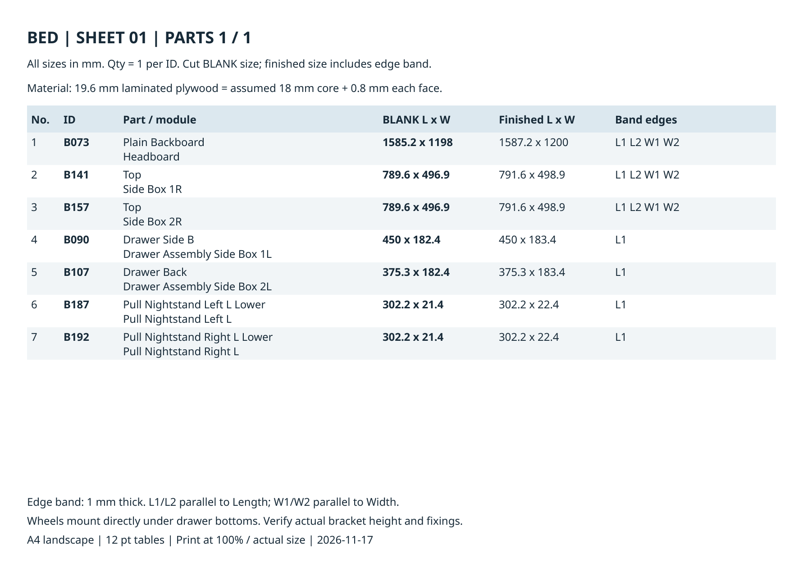
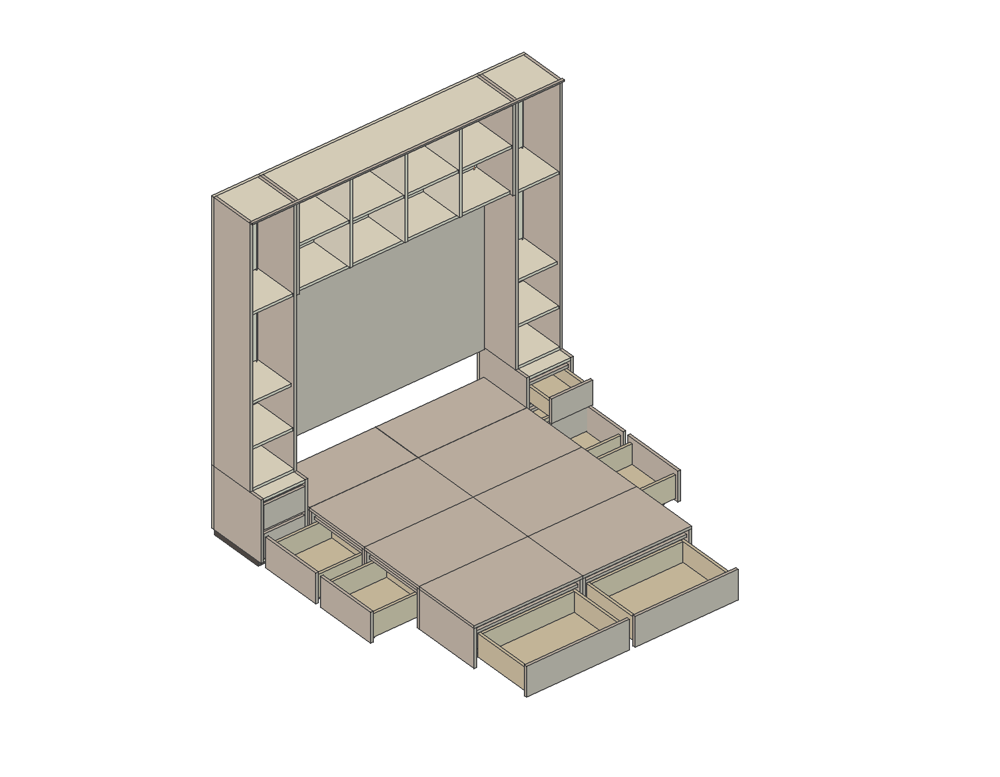
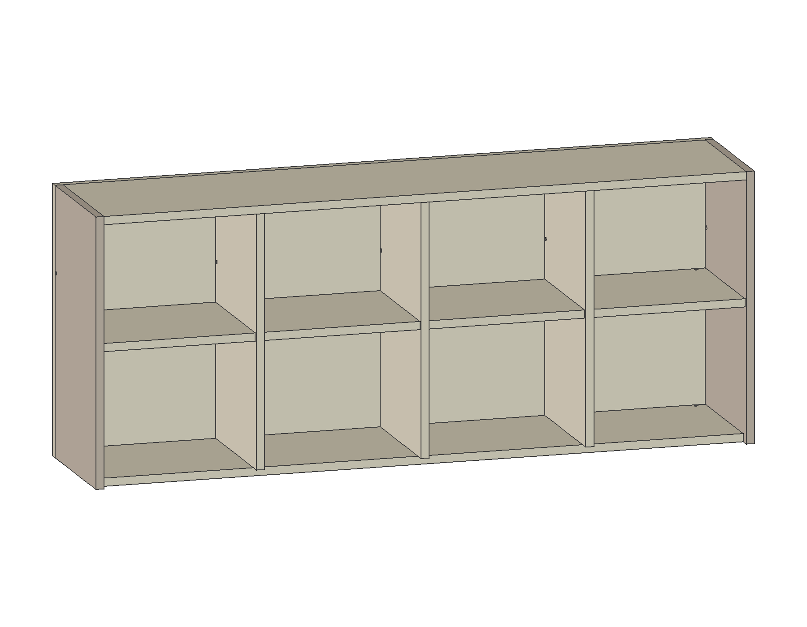
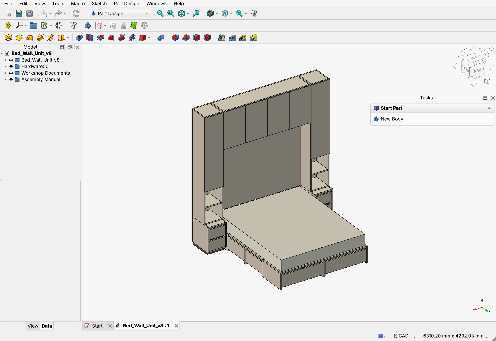

# Current screenshots — bed v9 and cabinet v9

**Build one complete module, then move to the next.**

[Bed — module-by-module assembly PDF](../workshop/bed/Module_by_Module.pdf) · [Cabinet — module-by-module assembly PDF](../workshop/cabinet/Module_by_Module.pdf)

[Bed: individual module checklist](../workshop/bed/modules/README.md) · [Cabinet: individual module checklist](../workshop/cabinet/modules/README.md)

| Example: completed side drawer bay | Same bay — exploded construction |
| --- | --- |
|  |  |

Each module pack includes assembled / exploded / interior views, its own whole-mm parts targets and banding diagrams, build steps and a completion checklist. **Bed: 14 modules + final installation. Cabinet: 7 module groups + final installation.** Build that module's own drawers before moving on, subject to actual hardware fit. The TV centre and drawer tower share structure. Every plywood part appears once across the module packs; final site-fit scribes are assigned to installation.

Sheet nesting remains a separate cutting-batch plan: gather labelled parts from their stock sheets into each module kit. Rounded targets still require dry-fit; connector / wall-fixing patterns and hardware fit are not finalized by these guides.

**Updated 2026-11-17 — bed v9: wheels mount directly under the drawer bottoms.** All 24 plywood wheel pads are removed. The six drawer bottoms are 19.6 mm lower, with taller sides/backs; fronts and travel stay in place. Wheel diameter is 25.4 mm; the assumed 35 mm overall mounting height and actual fixings still need checking.

| Current bed v9 — full design | TV / makeup / wardrobe v9 — current design |
| --- | --- |
|  |  |

| Direct wheel plate mounting — cropped underside detail | Bed v9 drawers open — interior and travel |
| --- | --- |
|  |  |

**Readable cut lists:** A4 landscape, 12-point tables, separate numbered maps, complete parts tables and saw steps. Print at **100% / actual size**. The layout includes **4 mm kerf** and **5 mm trim per sheet edge**.

[Bed cutting PDF](../workshop/bed/Cutting_Layouts.pdf) · [Cabinet cutting PDF](../workshop/cabinet/Cutting_Layouts.pdf) · [Bed v9 model](../Bed_Wall_Unit_v9.FCStd) · [Bed v9 drawings](../Bed_Wall_Unit_v9_Drawing.FCStd)

| Bed — larger parts table | Cabinet — larger parts table |
| --- | --- |
|  |  |

For the same readable pages inside FreeCAD, open [bed cutting pages](../workshop/bed/Readable_Cutting.FCStd) or [cabinet cutting pages](../workshop/cabinet/Readable_Cutting.FCStd). The bed v9 main model also contains the new cutting pages. [Earlier bed v8 pack — history](../workshop/history/bed_v8_before_direct_mount/README.md).

History — bed v8 and earlier screenshot set (wheel pads superseded)

# Current screenshots — bed v8 and cabinet v9

**Bed v8: ONE plywood backboard panel; foam and extra substrate removed.**

All drawers now have nested groups inside their cabinet modules. These views show actual FreeCAD drawer isolation:

| Bed nightstand drawer | Makeup cabinet drawer |
| --- | --- |
|  |  |

[Bed drawer alone](bedframe_v8_isolated_drawer.png) · [Makeup cabinet drawer alone](cabinet_v9_isolated_drawer.png)

Captured from disposable copies of the saved FreeCAD models; source models are not saved during capture.

Bed frame and surrounding cabinets — full design:

TV / makeup / wardrobe cabinet — full design:

Bed lighting — profiles, cable routes and driver (panels transparent):

Makeup lighting — profiles, cable routes and driver (panels transparent):

Under-bed drawer — four 1-inch wheels, viewed from below:

Bed drawers open — wheel travel and room clearances:

Bed plywood L/C pulls — concealed ends:

Makeup plywood L/C pulls — concealed ends:

Bed front:

Bed interior:

Bed overhead dividers:

Cabinet front:

Cabinet interior:

Cabinet top-box divider:

Native cutting page in FreeCAD:

Run `../capture_workshop.FCMacro` in FreeCAD to refresh the 14 model views. Older screenshot versions are historical.

