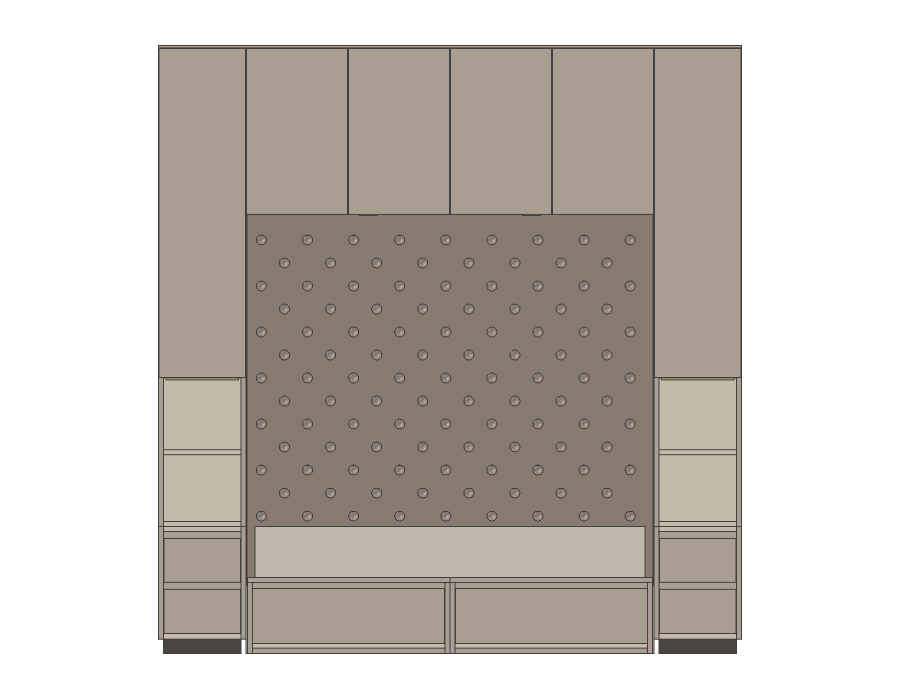
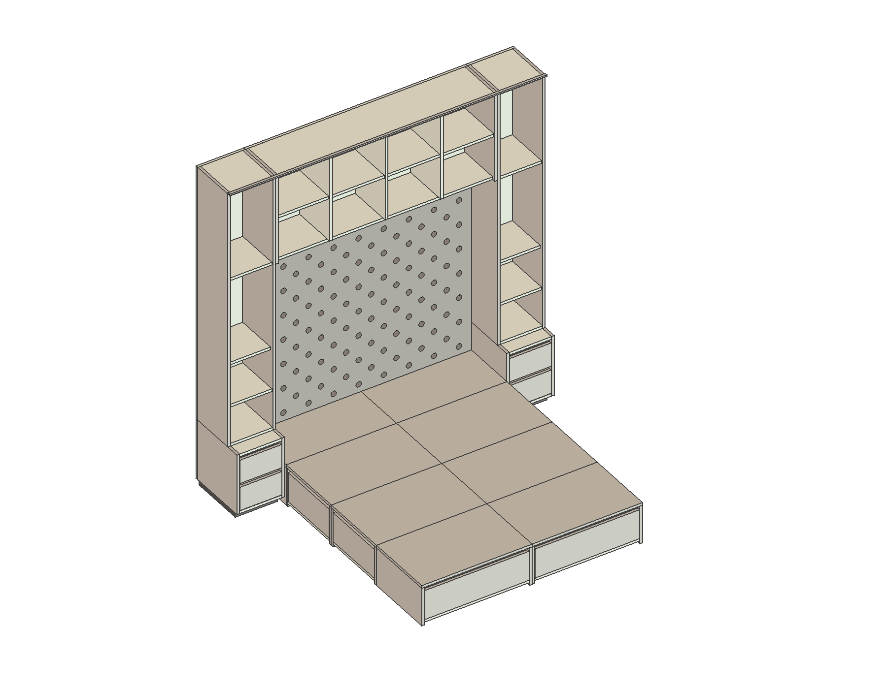
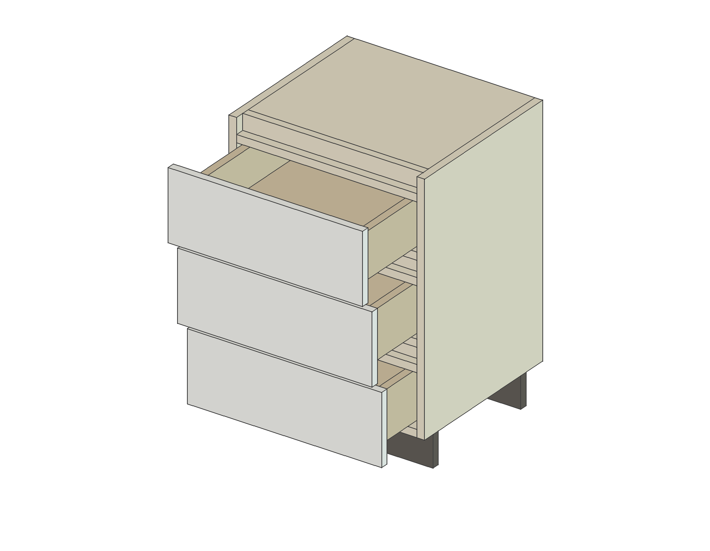
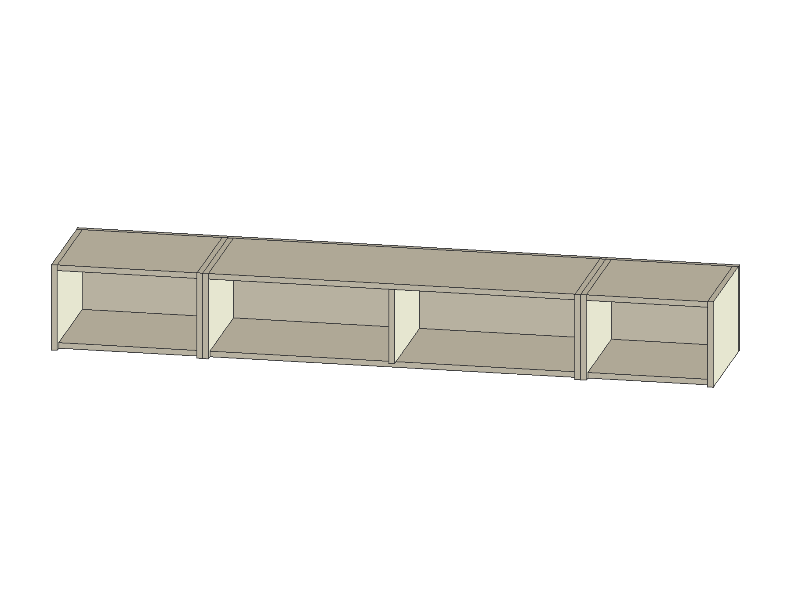
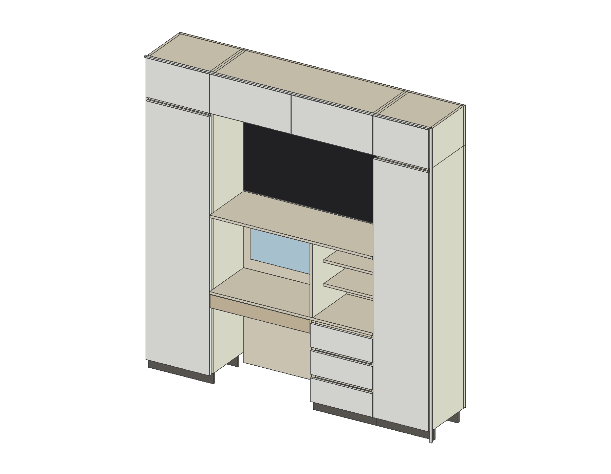
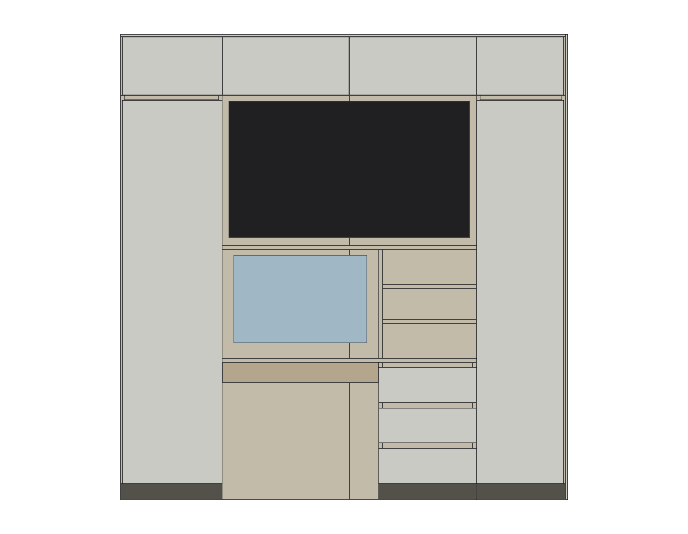

# Bedroom project screenshots

These are two separate projects, captured from the saved FreeCAD models.
The furniture geometry is unchanged in these images. Reference walls
are hidden so the furniture is visible.

## Bed frame with surrounding cabinets — v6

### Plywood L/C drawer grips — drawers open

L under the top, C between stacked drawers; square-edged fronts. Existing sides close the ends; no extra cover panels or door-cabinet notches.

Source: `../Bed_Wall_Unit_v6.FCStd`. Three full-height overhead dividers
create four compartments, each with its own shelf panel.

### Overhead cabinet detail — doors hidden

### Angled view

### Front view

### Cabinet interiors

Doors and mattress are hidden in this view. Storage-box lids remain in place.

## Cabinet with makeup table and TV — v8

### Plywood L/C drawer grips — drawers open

Source: `../Bedroom_Cabinet_Modern_v8.FCStd`. A centre divider splits
the two-door top box into two compartments. The single-door side top boxes
each already have their own compartment.

### Top cabinet detail — doors hidden

### Angled view

### Front view

### Cabinet interiors

Cabinet doors are hidden to show the shelves, hanging rail, and top boxes.

## Recapture

Run `../capture_screenshots.FCMacro` in FreeCAD to recreate the ten current PNGs.
Images are 1800 × 1400 pixels. The macro creates temporary view documents;
it does not save changes to the source models.

Earlier revisions remain for comparison, including the bed v5 / cabinet v7 images with exposed notch ends.
