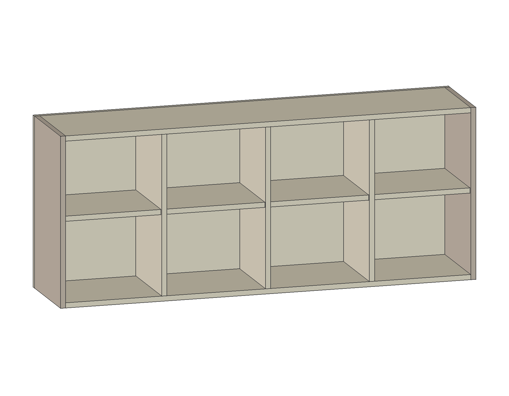
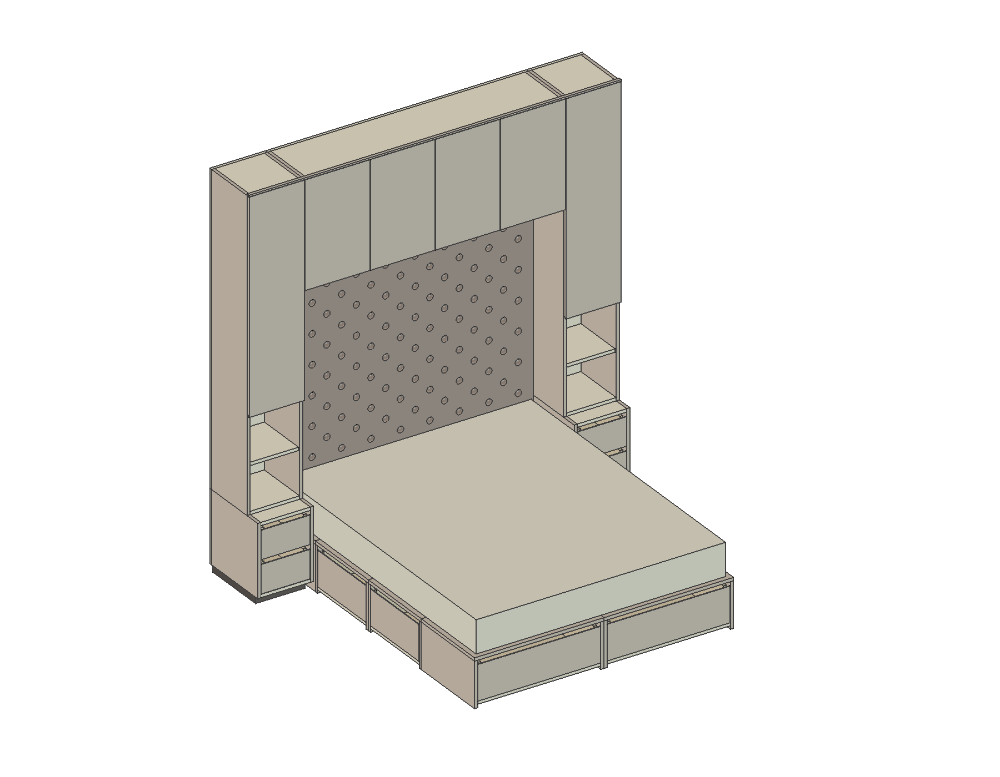
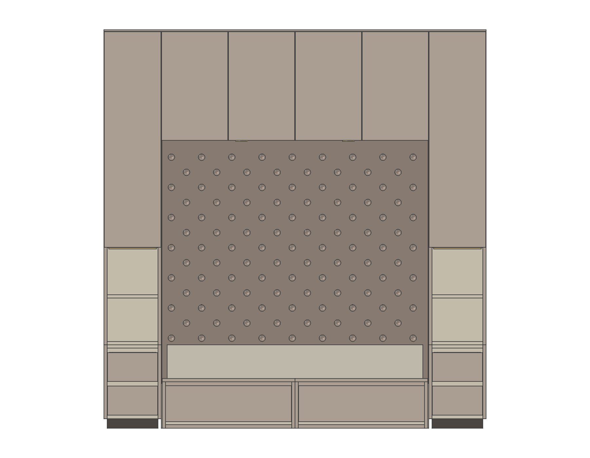
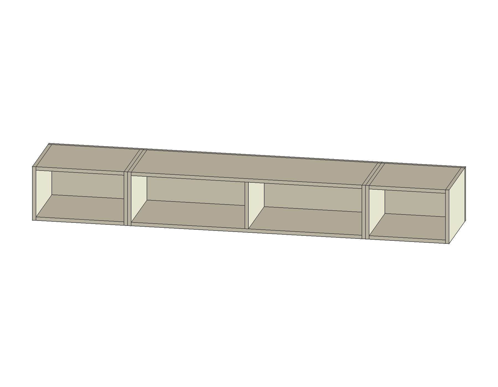
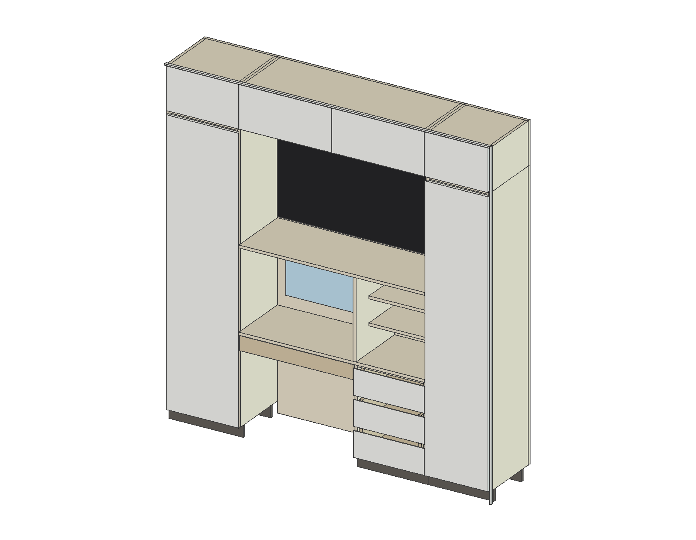
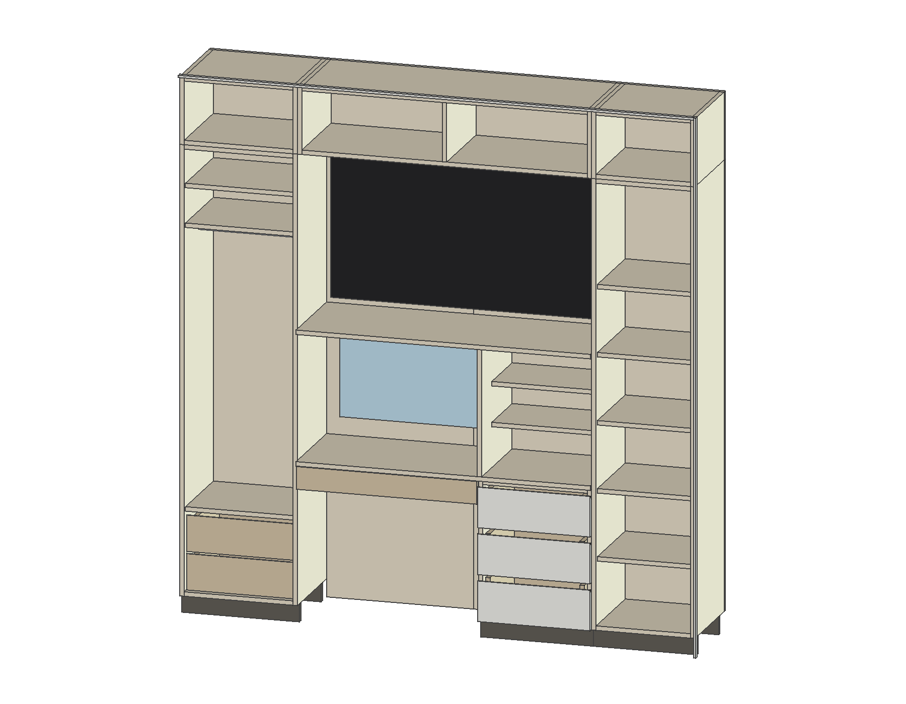

# Bedroom project screenshots

These are two separate projects, captured from the saved FreeCAD models.
The furniture geometry is unchanged in these images. Reference walls
are hidden so the furniture is visible.

## Bed frame with surrounding cabinets — v4

Source: `../Bed_Wall_Unit_v4.FCStd`. Three full-height overhead dividers
create four compartments, each with its own shelf panel.

### Overhead cabinet detail — doors hidden

### Angled view

### Front view

### Cabinet interiors

Doors and mattress are hidden in this view. Storage-box lids remain in place.

## Cabinet with makeup table and TV — v6

Source: `../Bedroom_Cabinet_Modern_v6.FCStd`. A centre divider splits
the two-door top box into two compartments. The single-door side top boxes
each already have their own compartment.

### Top cabinet detail — doors hidden

### Angled view

### Front view

### Cabinet interiors

Cabinet doors are hidden to show the shelves, hanging rail, and top boxes.

## Recapture

Run `../capture_screenshots.FCMacro` in FreeCAD to recreate the eight current PNGs.
Images are 1800 × 1400 pixels. The macro creates temporary view documents;
it does not save changes to the source models.

The earlier `bedframe_v3_*.png` and `cabinet_v5_*.png` images remain for comparison.
