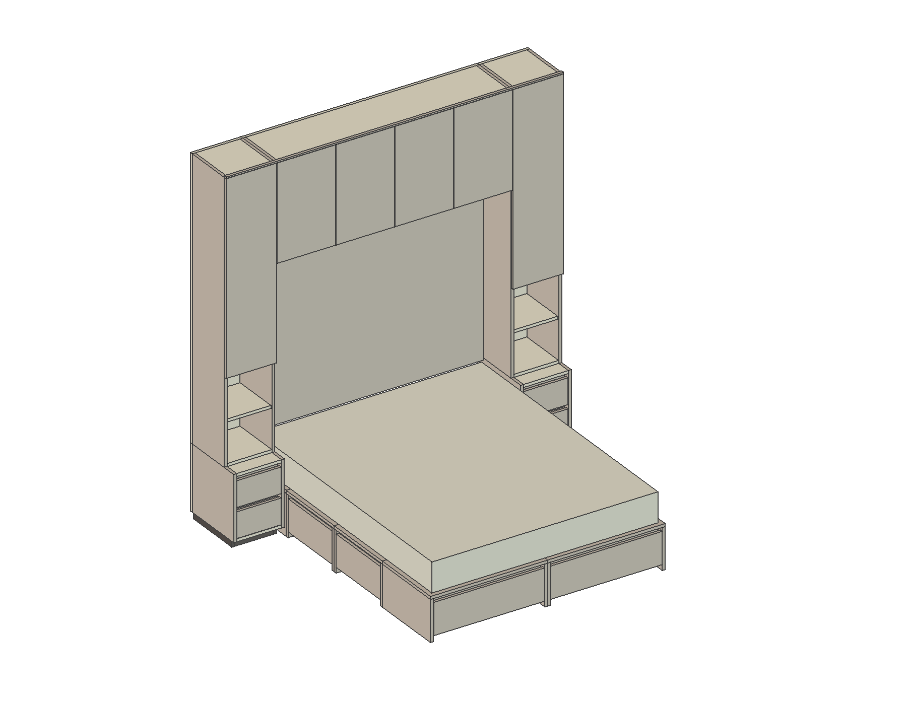
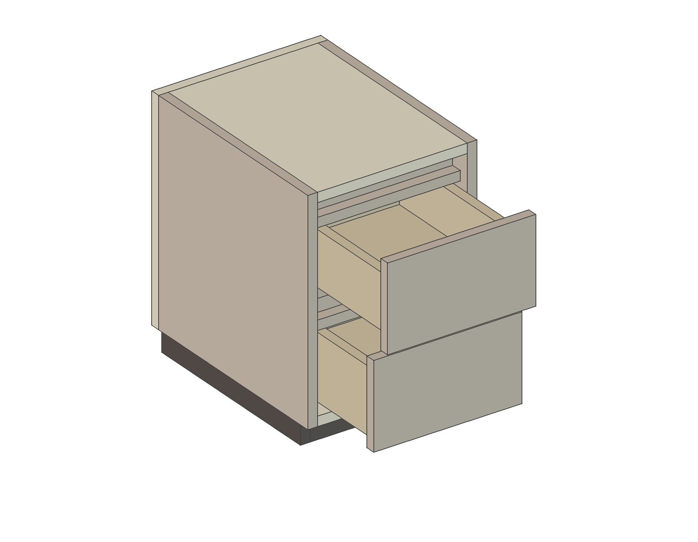
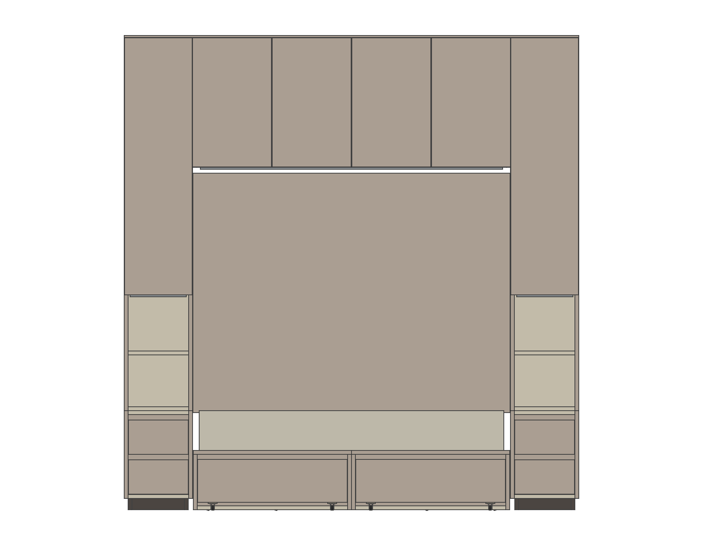
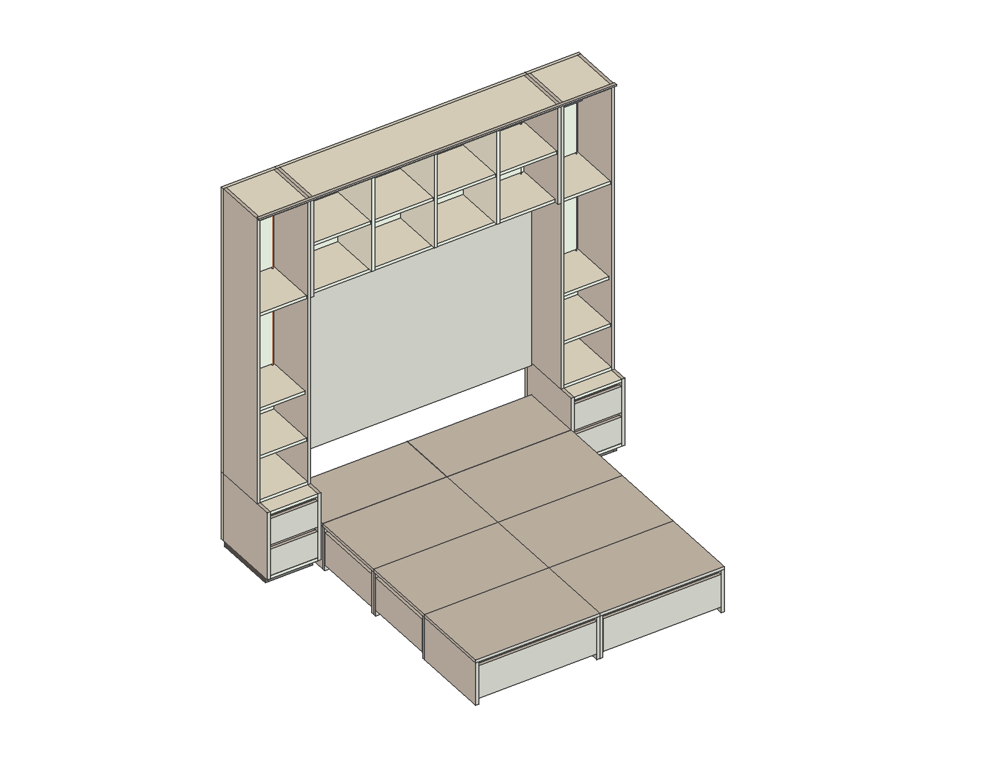

# Current screenshots — bed v8 and cabinet v9

**Bed v8: ONE plywood backboard panel; foam and extra substrate removed.**

Captured from disposable copies of the saved FreeCAD models; source models are not saved during capture.

Bed frame and surrounding cabinets — full design:

TV / makeup / wardrobe cabinet — full design:

Bed lighting — profiles, cable routes and driver (panels transparent):

Makeup lighting — profiles, cable routes and driver (panels transparent):

Under-bed drawer — four 1-inch wheels, viewed from below:

Bed drawers open — wheel travel and room clearances:

Bed plywood L/C pulls — concealed ends:

Makeup plywood L/C pulls — concealed ends:

Bed front:

Bed interior:

Bed overhead dividers:

Cabinet front:

Cabinet interior:

Cabinet top-box divider:

Native cutting page in FreeCAD:

Run `../capture_workshop.FCMacro` in FreeCAD to refresh the 14 model views. Older screenshot versions are historical.
